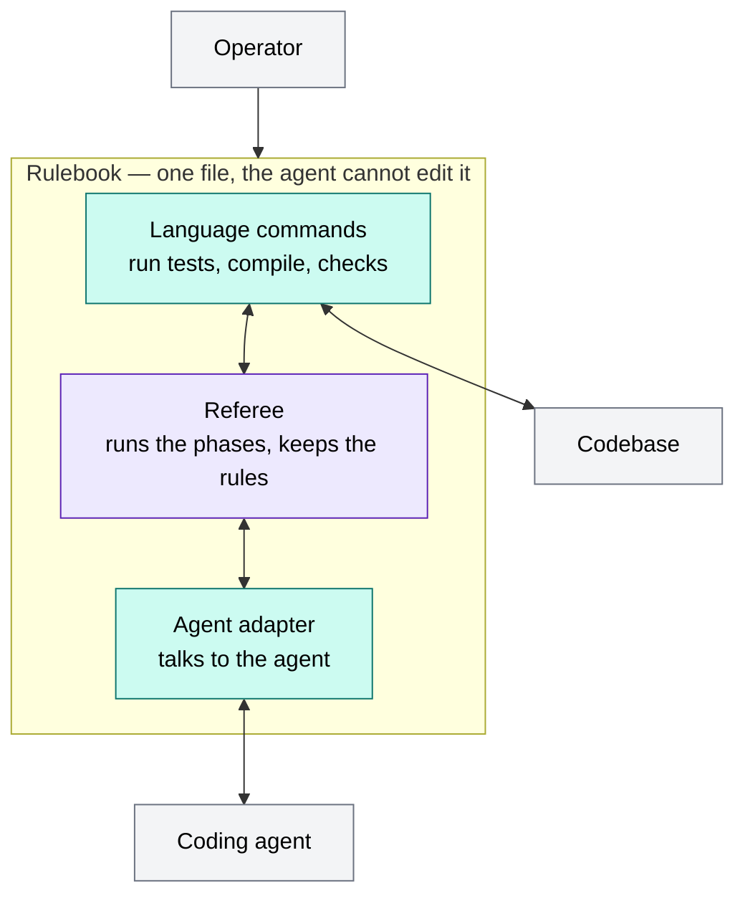
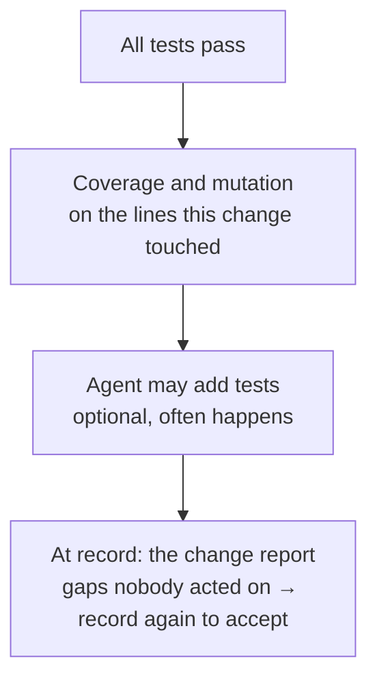

# Harness vision

Where the split between the referee, the adapters and the rulebook is
going. Agreed with the operator on 2026-10-21, the language part revised
with the operator on 2026-10-31, and mutation's report and survivor
accounting added on 2026-11-01. Where this differs from the code today, the
code is behind.

## In one paragraph

The harness walks an agent through a change in a fixed
order, and it cannot be talked out of the order. The **referee** holds the rules
and knows nothing about languages, agents or file layouts. The **language
side** is configuration: commands the rulebook names, and the report files they
write in formats most tools already know. The **agent adapter** talks to the
agent. The **rulebook** is one file the operator writes, which names the
commands and the adapter and sets the house rules.

The agent adapter is a translator. The referee asks a question in its own
words, and the adapter hands back plain JSON. Adding an agent means writing an
adapter.

The language side needs no translator. A language is the paths and commands
in the rulebook, and the referee reads what the commands leave behind: a JUnit
XML report of the test run, an lcov coverage report, a mutation report in the
format the Stryker tools write, and otherwise an exit code and text for the
agent and the operator. Adding a language means writing rulebook entries
and, at most, a reporter for what those reports lack. In neither case does the
referee change.

Neither side holds one project's choices. The harness holds what is true of
the workflow, of a language or of a tool. How a project runs its tests and in
what order, which folders it has, which hosting platform it merges on, how it
starts the referee: those are the project's, and live in the project, in its
rulebook, its scripts, its runner's config and its own instructions. A
harness file that names them breaks, or carries them along, the moment the
harness is used anywhere else.

Translators were the first design. Each language command printed the
referee's own JSON, and no real tool prints that, so every language needed
translator code: about 1,700 lines for TypeScript. Formats most tools already
write move that work out of the project.

## What each part owns

### Referee — runs the phases, keeps the rules

It decides. It never starts a language tool or names one.

- The phases, in order: plan approved → code written with tests frozen →
  triage → tests written → verify → test quality → record.
- What the agent may do in each phase.
- The logbook: one entry per event, append-only, linked so a missing or edited
  entry shows. The baseline: the commit a change is measured from.
- Approvals, which only the operator gives.
- The requirements: their format, that none is weakened, that each has a
  test that really runs.
- What counts as proof, and the verdict on every check.
- Reading the two report formats the language side writes: JUnit XML for
  test results and lcov for coverage. They are file formats, not tools, so
  reading them names no tool.
- The quality report, and where the reviewer must look.
- The workflow's instructions and the harness support skills, as prompts any
  agent can follow.
- `init`: starts a project, new or existing.

It reaches the outside in three ways only: `git`, its own Node running its
own files, and the commands the rulebook names. It talks to the agent adapter
through commands and JSON, so an adapter can be written in any language. From
the language commands it reads the reports they write, their exit codes, and
their text, which it passes on without reading.

### Language side — configuration

It answers. It never judges pass or fail. The operator and the agent write it
into the rulebook together, and `init` asks no language for defaults.

**The paths.** Which files are tests, which are test support and which are
code. The operator decides these, not a language.

**Three test categories.** Under `tests.paths`, `all` finds every test
file and `acceptance` selects the tests that can prove requirements. Both
are required glob lists. The optional `slow` globs cover end-to-end,
performance and other long-running tests. Both subcategories select from
`all`. A slow test may also be acceptance when the promise needs it.

Verify and triage run every test. Fast runs leave out the slow selection.
Only acceptance files supply scenario tags. Mutation runs fast tests only.

**The test run.** One command runs the tests and writes a JUnit XML report. The
referee reads pass, fail and skip from it, and the tags:

- A tag is read from the test's name when the name holds one, as a Vitest
  title or a Go subtest name does.
- When the name cannot hold one, as with a pytest function or a Rust
  function, the tag is read from a comment directly above the test. The
  rulebook gives the comment pattern, because each language spells comments
  differently.
- The test's file comes from the report, or from finding the test's name in
  exactly one file the test globs match. When no file or several files match, or a reported file falls outside `all`,
  the referee refuses and names the test. It never guesses.
- A file the test globs match that the report leaves out failed to load. For an acceptance file its
  tags are found by searching the whole file for them, and those requirements
  fail. This is the strict reading: a file the runner deliberately never
  collects counts as failed too, and the fix is a narrower test glob.
- A test's text must match its scenario word for word, compared by words
  only. Case, whitespace and punctuation are ignored. Apostrophes are dropped,
  so `proposal's` and `proposals` are the same word, and any other symbol,
  `_` included, counts as a space. camelCase is not split, because a scenario
  may contain a camelCase word of its own. Group names in front of a title,
  after `>`, `/` or `::`, may fall away. Leading words of the title itself may
  not, so `Not a rejected proposal` never matches `A rejected proposal`.

`req:trace` reads the last run's report, so verify runs it after the tests.

**The reporter.** A plain JUnit report cannot say everything the referee
wants. A reporter is the one file that writes a report that says it: a test
framework plugin such as a `conftest.py` or a Vitest reporter, or a script
that rewrites a plain report. It adds agreed JUnit properties to a test:
`file`, `scenario`, `line`, `endLine` and `inverted`. Without a reporter:

- tests expected to fail, such as Vitest's `.fails`, are reported as not
  checked. A plain report shows them as passing, and the referee cannot tell;
- a compile error in a test file fails the whole file, because there are no
  line ranges to find the one test it sits in.

The project’s test command loads its reporter. Include the reporter and its
helpers in `tests.paths.support` to freeze them, and in `highRisk` to flag
edits for review. A reporter supplies the tags that identify a scenario’s evidence.

**Compile.** A command, and a rulebook regex with named groups for the file,
the line and the message, which reads the compiler's output. The rulebook also
says what each exit code means, `clean`, `errors` or `broken`, because many
compilers exit non-zero when they find an error, and a code nobody listed means
the compiler broke. An error in a test file is a failed test. An error in any
other file means the implementation is unfinished. A language without a
compile step says `"none"`.

**Two chains of checks.** The quality chain holds coverage, mutation, and
anything added later. The code-check chain holds lint, static analysis,
security scans, architecture rules and build. Ordinary entries specify:

- a command, and the exit codes that mean clean, findings or broken, single
  codes or ranges such as `1-255`;
- how often it runs: on every verify, the default, or once per plan;
- what a failure does: block verify, the default, or only report;
- a time limit, 300 seconds unless it says otherwise;
- optionally, its suppression comments, such as `# nosec` or `eslint-disable`.

Every entry runs inside verify. A change that adds a suppression comment goes
under "Must look". A check's config files go in the high-risk list, which
already says why a file needs reading. Silencing a check is the way to weaken
it without a failing test, as editing a requirement is for a test. The referee
passes `{baseline}` and `{changedFiles}` to a command, so a tool can limit
itself to this change. Without that, a scanner turned on in old code finds
hundreds of old problems and blocks every change. The referee never reads a
finding. It reads the exit code and passes the text on.

Both built-in entries are required and either can be `"none"`. Enabled coverage runs `always` and blocks on failure. Mutation runs `oncePerPlan` and reports findings.

- **Coverage** supplies LCOV through its command. The referee checks folder
  minimums and calculates coverage of touched lines, then saves the analysis
  at `output`. Later reports read that analysis. The test command clears old
  source coverage before running tests, and usually writes the source report.
- **Mutation** gets the lines this change touched and the time limit from the
  referee, writes a report of each mutant in the mutation testing report
  schema, prints text, and answers by exit code. 0 means no survivors. 1
  means confirmed survivors, which count toward the gaps considered at `record`. 2 means the run proves
  nothing, such as no test reaching the lines or the run stopping at its time
  limit. Any other code means it crashed. A run that tested nothing must not
  read as clean, and a wrapper script around the tool keeps that honest. The
  wrapper is named for its tool, such as `stryker-mutate.ts`, and is the
  rulebook's mutation command. A broken wrapper or invalid report fails verification. Which tests a run uses is the project's, in a
  config the project passes to the wrapper and lists as high-risk.

The import graph is gone from the language side. The triage no longer needs
it (see below), and the agent reads code itself before planning. Helpers that
read code for the agent may come later, per language and outside the
contract.

### Agent adapter — talks to the agent

It carries the referee's decisions to one agent. Claude Code and Codex have
one each. The contract between an adapter and the referee, with sequence
diagrams for both agents, is `agents/README.md`.

- Before a write: tells the referee which files the tool call writes, or the
  shell command it runs, and blocks what the referee denies. The referee decides
  every lock.
- Plan approval: makes sure the plan the operator approved is in a file
  directly in the plans folder, and tells the referee which file.
- End of turn: has the referee run verify, and passes the result back.
- Each prompt: shows the phase, and catches the operator's `record` and
  `reset`.
- Delivers what the referee marks for the operator, in whatever way its agent
  makes sure the operator sees it.
- Proposes its own config for the lock list (`.claude/settings.json` and the
  hooks, for Claude Code), and checks the agent's settings for anything that
  switches the hooks off.
- Installs the referee's instructions and skills for its agent, in the
  format and place the agent reads them, rewording them where its agent is
  better served. A project has no copy of the harness, so nothing installed
  points back into it.

### Rulebook — the house rules

One file. The operator writes it, and `init` drafts it.

- The target: the remote branch changes merge into.
- The language side: the paths, the test command and its report, the tag
  comment pattern, the compile command and its pattern.
- The agent adapter, as the commands to run.
- High-risk areas, each with its reason, such as migrations. The reviewer must read changes to those paths.
- The two chains of checks, each entry with its command, exit codes, how
  often it runs, what a failure does, its time limit and its suppression
  comments.
- Quality: coverage minimums per folder, and mutation's time limit.
- Optionally, the folder requirements live in.
- The agent's own config, which the referee locks along with its own.
- The plans folder and the follow-ups file. The follow-ups file, and the
  files directly in the plans folder, are writable in every phase. The
  operator can put them anywhere, inside the repository or out, except that
  the plans folder cannot be the repository root, and neither can overlap a
  lock.
- Whether the agent check lists hooks the workflow did not register. On by
  default.

## Two kinds of protected file

| | Agent can write? | Defined by | Examples |
|---|---|---|---|
| Always locked | No | The referee, plus the agent's config, which the rulebook lists | The logbook, the rulebook, `.git/`; `.claude/settings.json` |
| High risk | Yes. The reviewer must read it | The rulebook, seeded by `init` | Migrations, the package manifests, the test runner's config, the reporter, the config files of checks |

Locks bind only the agent. A person can edit anything, which is how a
deadlock is broken.

## The referee's non-negotiable rules

No rulebook can switch these off.

1. Only the operator approves a plan, declares a change finished (`record`)
   or starts over (`reset`).
2. One change per branch, from plan approval to merge.
3. No code edits before an approved plan.
4. Tests are frozen until the triage has run on the untouched suite, so every
   failure it sees was caused by the new code.
5. The harness runs verify itself. A pass is tied to the exact files on disk,
   and any edit cancels it.
6. Verify always includes the requirement checks and a full test run with
   nothing failing. Coverage folder minimums are a hard floor when the rulebook
   sets them.
7. A requirement is never deleted. It leaves only as `superseded` or
   `withdrawn`.
8. Changing a requirement needs the operator's approval and a change file.
9. Every active requirement has an acceptance test that really runs. Even a
   small library defines its behaviour with acceptance tests.
10. A test that no longer compiles counts as failed, and so does a test file
    the test report leaves out.
11. A command that crashes, or writes a report that is missing or malformed,
    gives no answer, never a pass.
12. The logbook is append-only and links up. A broken logbook stops everything.
    Where git and the logbook disagree, git wins.
13. The target is a remote branch. The baseline is pinned at plan approval,
    only moves forward, and must be proved on the server before a change is
    recorded. A local target is not supported: with nothing independent to
    check it against, the agent could move it.
14. The always-locked files above.

The requirement format belongs to the referee: ids, scenarios, and `[AC0001.1]`
tags in test titles, or in a comment directly above the test where a title
cannot hold one. The folder and the comment pattern are the only rulebook
options.

## The triage measures the plan

The risk the triage measures is how well the agent understood the change's
impact. A plan predicts failures only: under `predicted-failures:` it lists the
existing tests it expects to fail, by scenario id, by test file, or by file and
test name (`file::name`). Every test it
does not list is expected to pass. New tests are not predicted, because the
tests are frozen until the triage runs, so none exist yet. The approval records
the list in the logbook, so it cannot change after the operator has seen it.

The triage then has two buckets:

- **predicted**: a failure the plan listed;
- **surprise**: a failure it did not.

It also reports **over-prediction**: tests the plan said would fail that
passed. The risk level counts surprises and over-predictions together, the
plan's missed predictions, with failing invariants and unpredicted test files
that never ran, the test regressions. It never scores a file for where it is:
the high-risk list is review's, under "Must look". A surprise shows the agent
missed an effect. An over-prediction shows it did not know what its change
would do, and it is also what padding looks like: a plan that lists every test
to hide its surprises is caught here.

This replaces the AC delta, the AC blast radius and the import graph. The
graph's job was to file a failure in a test that imports a changed file as
"touched" rather than surprising. That spared the agent's prediction exactly
where it should be measured, and it never saw a test that reaches the code
through another process, such as a browser test. A reworded or retired
requirement is still declared under `requirement-changes:`, because that is
what the operator's approval covers. Its tests are expected to fail only if the
plan lists them.

## Test quality

The question coverage and mutation answer together: how good are the tests
this change just added, and should they be improved?

1. After all tests pass, coverage and mutation run together on the lines this
   change touched. Mutation is optional per project, with its time limit in
   the rulebook.
2. The report reaches the agent. It often acts on it, with a test for an
   uncovered line. That is welcome, not required. Each surviving mutant must
   be accounted for in the change file before `record`: caught by a test the
   agent names, or left, with the reason it changes nothing observable. No
   score blocks, because some mutants change the code without changing what
   it does.
3. Mutation runs once per plan and is not rerun by itself. It is expensive,
   and it is not meant to be strict. A rerun is the operator's call, by hand
   or by asking the agent. The one exception is narrow: the survivor lines
   alone are run again, a handful of mutants, to prove each "caught by" line.
   Coverage is fresh on every pass, because verify writes it anyway.
4. When the operator types `record`, the harness shows the change report
   first: a summary of counts, then the high-risk areas, the surprises, the
   requirements changed and how well they are tested, coverage of the change,
   the mutation run, follow-ups, and anything not checked. The agent adds its
   reasons for the gaps, marked as its own. If gaps are left and the agent did
   nothing after the quality report, the first `record` only shows the report,
   and a second one declares.

No score blocks, and the operator judges. The folder minimums are the one
hard floor, and they only stop coverage falling overall. The survivor
accounting is the one thing `record` waits for, and it asks for reasons, not
a score.

## How we know we got there

- A test proves the referee starts only `git`, its own Node, and commands the
  rulebook names.
- Nothing the referee prints names a tool.
- The Claude Code hooks are thin translators over referee commands, so a Codex
  adapter needs no referee change.
- `init` sets up a new repository and an existing one.
- Later: a second language takes a real change through
  the whole loop with rulebook entries and at most a reporter, and no referee
  edit.
