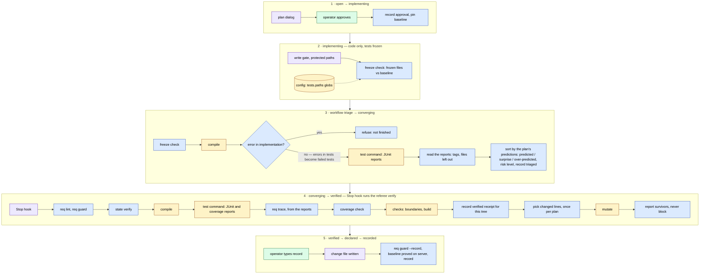

# Language adapters

The workflow's referee runs the same for every language. Everything under
`src/` except this folder and `../agents/` is referee. When the referee needs
an answer only the language can give, it runs a command named in
`.katatay/rulebook.json`. The test run is read from the JUnit XML reports its
command writes, a format almost every test runner can write. Coverage is read
from the lcov report the same command writes, a format almost every coverage
tool can write. The compile step is read from the compiler's own output, with a
pattern and a map of exit codes the rulebook gives. Mutation is read by its
exit code, with its text passed on to the reader. This file is the contract
those commands keep.

An adapter is a set of commands, not a program. A project can point a command
at a tool it already has, wrapped where the tool's exit codes do not keep the
contract below. `typescript/` is the adapter for TypeScript with Vitest and
Stryker, and `typescript/README.md` describes it.

An adapter holds what is true of a language or a tool, and nothing of one
project's. How a project runs its own tests, in what order, with which of its
runner's projects, is the project's, and lives in the project: its test
command, its scripts, its runner's config. The rulebook points at it.

This file is the contract as it stands. Where it is going is in
`../VISION.md`.

The referee never imports a language tool and never starts one by name. The
`referee-is-language-free` rule in `.dependency-cruiser.cjs` enforces the first
half, with no exceptions.

## What runs when

Blue is the referee. Amber is the language adapter. Purple is the agent's hooks:
Claude Code today. Green is the operator.



## The config

The `tests` and `code` sections live in `.katatay/rulebook.json`. No
session may write that file, so a session cannot point a command at a stub that
always passes. The rest of the rulebook (the target, the high-risk areas, the
extra checks, the quality settings) is described in `src/workflow/README.md`.

```json
{
  "tests": {
    "paths": { "all": ["**/*.test.{ts,tsx,mjs}"], "acceptance": ["**/acceptance/**", "**/*.acceptance.*"], "slow": ["**/e2e/**", "**/*.e2e.*", "**/perf/**"], "support": ["tests/**"] },
    "run": {
      "command": "rm -f coverage/lcov.info && npm test",
      "reportPaths": ["reports/junit/*.xml"],
      "tagComment": "^\\s*//"
    }
  },
  "code": {
    "paths": ["**/*.{js,jsx,cjs,mjs,ts,tsx,cts,mts}"],
    "compile": {
      "command": "npx tsc --noEmit --pretty false --incremental false",
      "pattern": "^(?<file>\\S.*?)\\((?<line>\\d+),\\d+\\): error (?<message>TS\\d+: .*)$",
      "exitCodes": { "0": "clean", "1": "errors" }
    }
  }
}
```

| Key | What it says |
|---|---|
| `tests.paths` | `all` and `acceptance` are non-empty lists of globs. Within `all`, `acceptance` selects requirement evidence and optional `slow` selects tests excluded from fast runs. Every verify and triage runs all tests. The freeze, the test run and the coverage check all ask this one rule (`isTest` in `src/workflow/frozen.mjs`). A test file the report leaves out counts as failed to load. |
| `tests.paths.support` | Files that help tests and hold none: fixtures and shared helpers. The freeze covers them as it covers tests, but `req trace` does not read them as tests. |
| `code.paths` | Which files are code: what coverage measures and mutation plants bugs in. Mutation leaves out tests, test support, and what the rulebook's `checks.testQuality.mutation.excludePaths` lists. |
| `tests.run` | The test run: see "The test run" below. |
| `code.compile` | The compiler or type checker, or `"none"`: see "Compile" below. |

Globs: `**` is any number of whole path segments, `*` anything within one
segment, `?` one character, `{a,b}` either. Dot files match like any other.

The adapter requires the settings above. Omitting `tests.paths.slow` makes all tests fast. A language without a
compile step sets `code.compile` to `"none"`, and the referee reports it as not
checked. An unknown field is refused with its path and the allowed keys.

## The test run

One command runs the tests and writes one or more JUnit XML reports. The
referee reads the test run from those reports, so a language needs a test
command and no translator. `src/evidence/test-run.ts` holds the reading,
and `src/evidence/junit.ts` the XML.

| Key | What it says |
|---|---|
| `command` | Runs every test, through the shell, from the repository root. Its output is passed through. Its exit code is kept: a runner exits non-zero when the run failed. |
| `reportPaths` | Globs for the JUnit files it writes. Each must start with a folder named in full, or be a path with no wildcard. |
| `tagComment` | A regular expression for a comment line, such as `^\s*//` or `^\s*#`. Where a test's name cannot hold a tag, the tag is in the comment lines directly above the test. |

**Before each run the referee deletes what `reportPaths` matches**, so a report an
earlier run left can never read as this one's. It refuses first when a glob
matches a file git tracks or would track: reports are ignored output. Standalone
`req trace` reads the working reports and refuses when none exist. During
verification the trace uses the run already parsed by the tests step. The
change report reads the XML preserved by that tree’s successful verification.

Each `<testcase>` is one test. Pass, fail (`<failure>` or `<error>`) and skip
(`<skipped>`) come from the report. Then:

- **Its file** is the `file` attribute of the test case or the suite around
  it, or a `file` property. Without one, the one test file that holds the
  test's name is the file. No file or several is a refusal that names the
  test, and so is a named file outside `tests.paths.all`, outside the repository, or not on disk. The
  referee never guesses where a test came from.
- **Its tags** are ignored outside acceptance files. For an acceptance file they are read from its name when the name holds one, as a Vitest
  title or a Go subtest name does. Else from `scenario` properties. Else from
  the comment lines directly above the test that match `tagComment`, as a
  pytest or Rust function would carry them. The test's line is the `line`
  property, or the one line of the file that holds its name. No such line
  means no tag, never a guess.
- **Its name must say its scenario, word for word**, compared by words only.
  Case, whitespace and punctuation are ignored. Apostrophes are dropped, so
  `proposal's` and `proposals` are one word, and any other symbol, `_`
  included, counts as a space. camelCase is not split. The group names a
  report puts in front of a title, after `>`, `/` or `::`, may fall away, and
  the title's own leading words never do: `Not a rejected proposal` never
  matches `A rejected proposal`. See `sameWords` in `src/evidence/tags.ts`.
- **A test file the report leaves out failed to load**, or the run never
  reached it. It is one failure for the whole file, and for acceptance files the tags are found by
  searching its whole text: those requirements fail `req trace`, and the
  triage gives the failure every one of them. This is the strict reading. A
  file the runner deliberately never collects counts as failed too, and the
  fix is a narrower `tests.paths.all` glob.
- **A non-zero exit with nothing in the report failing** is one more failure:
  the run failed outside any test, such as an unhandled error.

### The report writer

The test command can load a runner plugin, use a package or pass a plain JUnit
report through a script. The language adapter can supply a writer for its runner.
The referee reads these optional properties on each test case.

| Property | Value |
|---|---|
| `file` | The test file, from the repository root. |
| `scenario` | A requirement or scenario id, such as `AC0001.1`, when the name cannot hold a tag. May repeat. |
| `line`, `endLine` | The lines the test spans, 1-based, both or neither. The referee finds which test a compile error sits in from them. |
| `inverted` | `true` for a test that passes only when its body fails, such as Vitest's `.fails`. |

The referee refuses malformed properties. It treats an absent `inverted`
property as false. A runner that reports an inverted test as passing and omits
the property can therefore supply acceptance evidence without a warning.
Without a matching line range, a compile error in a test file fails the whole file.

For a writer kept in the project, the operator can freeze its files through
`tests.paths.support` and list them for review through `highRisk`.
A writer shipped in a package is outside the project tree.

The TypeScript adapter's reporter is described in `typescript/README.md`.

## Compile

The compile step is the language's compiler or type checker, run as it is.
The referee reads the compiler's own output, so a language needs a command and
no translator. `runCompile` in `src/workflow/adapter.mjs` holds the reading.
What an error means, a failed test or an unfinished implementation, is in "A
test that no longer compiles" below.

| Key | What it says |
|---|---|
| `command` | Checks the code, **test files included**, through the shell, from the repository root. Its stdout and stderr are both read, stdout first. |
| `pattern` | A regular expression that finds one error in the output. Named groups: `file` and `message`, required, and `line`, optional. |
| `exitCodes` | Map a single exit code or an inclusive range from 0 through 255 to `clean`, `errors` or `broken`. For example, `{ "0": "clean", "1-255": "errors" }`. Each code may appear only once. At least one code must mean `clean` and one `errors`. |

The referee needs three things from a compile run, and the three keys give
them. It needs to know whether the compiler checked anything at all, because a
compiler that broke must never read as a clean one. It needs the file of each
error, to tell an error in a test, which is a failed test, from one in the
implementation, which means the implementation is not finished. And it needs
the line, to find the one test the error sits in.

### What the exit codes mean

A map, not a list, so the rulebook says what each code means. A list said only
which codes were fine, and a reader could not tell "found errors" from
"crashed".

| Meaning | What the compiler says | What the referee does |
|---|---|---|
| `clean` | I checked everything and found nothing. | No errors. If the pattern matches anything anyway, the exit codes and the pattern disagree. One of them is wrong and the referee cannot tell which, so it refuses. |
| `errors` | I checked and found errors; they are in my output. | Reads them with the pattern. If the pattern matches nothing, it refuses: the compiler said it printed errors and none were found. Either the pattern does not fit, or the compiler broke and used the same code. tsc exits 1 for a type error and also for a project it cannot find. |
| `broken` | I could not check. | Refuses, with the first and last lines of the output. |

**A code the map does not list means `broken`.** Exit 2 and exit 134 are the
same to the referee when neither is listed: the compiler did not do its job,
and nothing is concluded. Writing `"broken"` for a code changes nothing. It is
there so a rulebook can name a tool's documented crash codes, such as
`"2": "broken"` for mypy, and a reader does not have to know the default.

A refusal is the same as any adapter failing: the triage records nothing and
verify fails at `compile`.

### How the output is read

- The pattern runs over the whole output with the `g` and `m` flags. `^` and
  `$` match at each line, so a one-line pattern reads one error per line, and a
  pattern that spans lines still works. Colour codes are stripped and `\r\n`
  read as `\n` first.
- Paths: `\` becomes `/`, a leading `./` is dropped, and an absolute path
  under the repository root becomes relative. A path outside the repository is
  kept as printed, and counts as an error in the implementation.
- `line` is 0 when the pattern has no `line` group or it did not match. The
  error then fails every test in its file.
- A match with an empty `file` is the pattern being wrong, and is refused.

The referee cannot see which files a compiler read. A command that leaves the
tests out, such as `cargo check` without `--all-targets`, or a `tsconfig.json`
whose `include` leaves out the test folders, finds no error in a test that no
longer compiles. Make sure the command checks the tests.

### Examples

Starting points, to check against the version of the tool you run. Each
pattern is shown as a regular expression; in the JSON, every `\` is written
`\\`.

| Language | `command` | `pattern` | `exitCodes` |
|---|---|---|---|
| TypeScript | `npx tsc --noEmit --pretty false --incremental false` | `^(?<file>\S.*?)\((?<line>\d+),\d+\): error (?<message>TS\d+: .*)$` | `{ "0": "clean", "1": "errors" }` |
| Java, Gradle | `gradle -q testClasses` | `^(?<file>\S+\.java):(?<line>\d+): error: (?<message>.*)$` | `{ "0": "clean", "1": "errors" }` |
| Go | `go test -run '^$' ./...` | `^(?<file>\S+\.go):(?<line>\d+):\d+: (?<message>.*)$` | `{ "0": "clean", "1": "errors" }` |
| Rust | `cargo check --all-targets --message-format=short` | `^(?<file>[^\s:]+):(?<line>\d+):\d+: error(?:\[E\d+\])?: (?<message>.*)$` | `{ "0": "clean", "101": "errors" }` |
| Python, mypy | `mypy .` | `^(?<file>[^:\n]+\.py):(?<line>\d+): error: (?<message>.*)$` | `{ "0": "clean", "1": "errors", "2": "broken" }` |
| PHP, PHPStan | `vendor/bin/phpstan analyse --error-format=raw --no-progress` | `^(?<file>[^:\n]+\.php):(?<line>\d+):(?<message>.*)$` | `{ "0": "clean", "1": "errors" }` |

Notes on them:

- **TypeScript.** `--pretty false` gives one line per error. `--incremental
  false`, because the cache cannot be trusted with this job: with exports
  removed from four modules whose tests still imported them, an incremental
  `tsc` reported 1 error from its cache and 35 without it. The triage counts a
  test that no longer compiles as failed, so a cached run would have called 34
  of them passing. `.*?` in `file`, because a path can hold parentheses, such
  as `src/(group)/page.tsx`. With `--noEmit`, tsc never
  exits 2, "errors found and output written anyway", so 2 is left out.
- **Go.** `go build` does not compile `_test.go` files. `go test -run '^$'`
  compiles every test and runs none. It also runs a few `go vet` checks, whose
  findings are printed the same way and count as errors.
- **Rust.** cargo exits 101 when it finds errors. Without `--all-targets` the
  tests are not checked, and without `--message-format=short` the file and the
  message are on different lines.
- **A tool that checks one file per call**, such as `php -l`, `ruby -c` or
  `node --check`, needs a loop the project writes, which goes through every
  file and exits with a code the map lists. Watch the loop's own exit code:
  `xargs` stops at the first command that exits 255, which is what `php -l`
  exits with on a parse error. The loop is the project's script, and the
  referee never knows of it.

## Coverage

Coverage is configured under `checks.testQuality.coverage`. The test command clears old coverage output before running tests.
A command then supplies LCOV on stdout, for example `cat coverage/lcov.info`.
LCOV is a file format supported by many languages, so no translator into the
referee's own schema is needed. Diagnostics belong on stderr.

Enabled coverage runs on every verify and blocks on failure. Supply at least one folder and both its line and branch minimums. The referee checks folder minimums, calculates coverage of touched lines, and
writes the completed analysis as JSON to `output`. Inside verify it keeps the
raw LCOV and the analysis as snapshots named on the verification's event, and
later reports read that analysis, not LCOV or `output`. See the workflow
README's coverage-check contract.
Set `checks.testQuality.coverage` to `"none"` to disable coverage. The referee reports this choice.

What the referee reads, inside each block that `SF:<path>` opens and
`end_of_record` closes:

- `DA:<line>,<count>` is a line that can run. It is covered when the count is
  above 0. A line counts once, at the highest count any record gives it.
- `BRDA:<line>,<block>,<branch>,<taken>` is one way a branch can go. It is
  covered when `taken` is above 0. `-` means the code holding it never ran.
- `LF`, `LH`, `BRF` and `BRH`, when given, must agree with the block's
  records. The referee refuses a report whose numbers disagree, because the
  writer is wrong in one of them and the referee cannot tell which.
- Every other record is left alone. Function coverage is not read.

A file named in two blocks, as when two runs' reports are joined, is merged.
A path is from the repository root, or absolute under it; a path outside it is
a refusal. So are a record the referee cannot read, a block with no
`end_of_record`, and no report at all: no report is never "nothing measured".

Check that every code file the coverage check should see is in the report, a
file no test loads included, at 0. Most tools leave such a file out unless
told to include it, and the coverage check fails a code file the report
leaves out.

## Mutation

Set `checks.testQuality.mutation` to an object or `"none"`. The referee chooses
the lines and the time limit and sends them to the configured command. It
reads the exit code, the text from stdout, and the fresh standard report at
`checks.testQuality.mutation.output`. The report path must name one ignored,
untracked file inside the repository. Supply `excludePaths` as a list of
globs, empty when every eligible path can be mutated. The time limit defaults
to 300 seconds. Mutation runs `oncePerPlan` and its findings policy is
`report`. A broken command or invalid report fails verification.

The command writes the mutation testing report schema, versions 1 or 2.
Stryker's `json` reporter writes this format directly. A tool with another
format needs a converter that writes it before the command exits. The
converter must preserve mutant ids, source files, complete locations and
statuses. Optional test associations may be included for future consumers.

Before running the command, the referee removes the previous report. After
exit 0, 1 or 2 it requires a new readable report, checks the required fields
and statuses, and derives counts and survivors. An explicit survivor with
zero completed tests is counted as unproven. Missing reports, invalid fields,
duplicate ids within a file, and exit/report contradictions make the run
fail with exit 3. The tool's text and the report error reach the reader.

The referee stores the findings with the run's logbook event, so replacing a
report file later cannot change what an earlier run found. Older events keep
their outcome-only summaries.

| Exit | Means |
|---|---|
| 0 | No mutant survived, by the tool's own account. The referee says so in those words: a tool that ran no test could say the same, so it is never proof that the tests catch every mutant. |
| 1 | Mutants survived. That holds `record` once, as a touched line no test runs does. |
| 2 | The run proves nothing: no test reaches the lines, a mutant tests reach ran no test, or the run stopped at its time limit before it checked one. |
| any other, or a signal | The command crashed. |

Exit 0, 1 or 2 with nothing on stdout is a crash too. The command always says
what it found, and a Node process that dies on an uncaught error exits 1,
which would otherwise read as "mutants survived".

The question comes on stdin, not as arguments, because paths such as
`src/[id]/(group)/page.tsx` would need shell quoting:
`{ "targets": [{ "file", "lines": [start, end] } | { "file" }], "budget", "verbose"? }`.
A target without `lines` is a whole new file. `budget` is seconds, or `null`
for no limit. The command keeps the budget itself: it stops there and says
what it checked by then. A run cut off with survivors among what it checked
exits 1, because those survivors are real; one cut off with none exits 2. The
referee stops it a few seconds later only as a backstop, and counts that as a
run that proves nothing, because a process stopped from outside may leave its
workers running. `verbose` asks for the tool's own log, on stderr.

A wrapper is named for the tool it wraps, such as `stryker-mutate.ts`, and
holds what is true of that tool. Which tests a run uses, and which it leaves
out, is the project's, so the project passes its own config to the wrapper as
an argument. The wrapper reports findings. A project lists its config files in the
rulebook's `highRisk` and in `checks.testQuality.mutation.excludePaths`.

The TypeScript adapter's wrapper, `typescript/stryker-mutate.ts`, is described
in `typescript/README.md`.

## Command output

No language command returns a JSON answer on stdout. The referee reads JUnit
files for tests, text and exit codes for compile, LCOV from the coverage
command, and text, exit codes and the standard report file for mutation.
Mutation targets still arrive as JSON on stdin. Send tool diagnostics to
stderr and let stdout drain before exiting, including for a long report.

- **Paths are relative to the repository root, with `/`.**
- **Tags are the referee's job.** A report gives names as the runner built
  them. The referee reads `[AC0001.1]` out of them, so an adapter never has to
  know what a requirement is.
- **Never guess.** Leave out what you cannot know rather than guess it: a
  reporter with no line range for a test gives neither `line` nor `endLine`. A
  guess in the generous direction is how a test that never runs comes to
  count as evidence.

## Test quality: coverage and mutation

Both grade the tests rather than the code. Coverage says which lines some test
ran. Mutation says whether a test would notice if a line were wrong. Both run inside verify. Coverage measures each tree. Mutation runs until
the turn-end hook records the plan's findings on a successful verify.
Survivors and valid inconclusive results are reported. A broken run fails
verification. The verified message displays both checks.

Set either quality entry to `"none"` to switch that check off independently.
The referee reports "not checked" for each check switched off. Only the operator
can edit this configuration.

Two rules a mutation wrapper keeps, because the referee cannot check them:

- **A mutant no test ran against is never a survivor, and never caught.** A
  runner that skipped every test would otherwise list every mutant as a
  survivor, or report a clean run. One such mutant makes the run exit 2.
- **A status the tool gives that the wrapper does not know is a crash.** Mapped
  to the nearest guess, it could become a caught mutant nobody caught.

The ignore comments are the coverage tool's business: it is what leaves the
marked code out of the figure. The referee only notices a change that adds one,
because that is how to stay above a minimum without a test, and lists the file
for review. The coverage entry's `suppressions` say how the language spells
them.

## A test that no longer compiles is a failed test

Whatever the language, a test that no longer compiles after the change counts
as a failed test: a type error, a syntax error, a missing import. It is never
a refusal, and never skipped quietly. Refusing deadlocked any change to a
public contract, because the tests that needed changing were frozen until the
triage ran. And a test can pass at runtime by luck while it no longer
type-checks, such as one comparing two promises where it used to compare two
projects. See `src/evidence/typecheck.ts`.

The referee holds to that by two routes:

- **`compile`.** An error in a frozen file fails every test it sits inside,
  found from the line ranges the reporter gives, or the whole file when it
  sits in none or no reporter gave ranges. An error in an implementation file means the implementation is
  unfinished, so the triage refuses until it compiles. In verify, any error
  fails.
- **The test report.** A test file the runner cannot load, such as javac
  failing a test class or a Python `ImportError` at collection, is left out of
  the report, and a file left out is a failure. So a language with
  `"compile": "none"` still sees it fail.

What `"compile": "none"` gives up is only the lucky pass: a test that runs
green while it would fail a type check. A Python project that uses mypy names
it as its `compile`.

That lucky pass happens only where the test runner runs code without checking
its types: TypeScript under Vitest, Python, PHP, Ruby. In Java, Go or Rust a
test that does not compile cannot run, so the report already leaves it out.
There `compile` adds the line, which fails one test rather than the whole file
or package, and the refusal when the implementation does not compile.

## Writing an adapter for another language

1. Point `tests.paths` and `code.paths` at the language's
   conventions.
2. Name the test command and the JUnit reports it writes in `tests.run`, such as
   `pytest --junitxml=reports/junit.xml`, and the comment pattern. Check that
   every test file the `tests.paths.all` globs match appears in the report: one that
   does not counts as failed to load. At least one reported test must pass.
   If every test was skipped, the probe refuses setup.
3. Write a reporter if the plain report lacks what the referee needs: the
   file of each test, the lines it spans, which tests are inverted. A pytest
   `conftest.py` can add them with `record_property`. Load it through the test command.
4. Name `code.compile`: the compiler or type checker, a pattern for its errors and
   what its exit codes mean, as "Compile" describes. Check the pattern against
   real output, a clean run and a run with an error in a test, and check that
   the command reads the test files. Write `"none"` if the language has no
   compile step.
5. Configure `checks.testQuality.coverage` if coverage is available. Clear old
   source coverage in the test command; supply LCOV through the coverage
   command and name the analysis destination in `output`. Include minimums
   and suppression patterns. Check that a file no test loads is measured.
   Otherwise set `checks.testQuality.coverage` to `"none"`.
6. Configure `checks.testQuality.mutation` if the language has a mutation tool, such as mutmut or
   go-mutesting, with a wrapper named for it that reads the question on
   stdin, prints what it found, and exits as "Mutation" describes. Check that
   a run in which no test ran exits 2, not 0. Otherwise write `"none"`.
7. Take a real change through the whole loop: approve, triage, verify, record.

The checks in steps 2 to 6 are run by `workflow init --probe`, which runs the
commands and reads them as verify does, and writes nothing. `init` itself
writes the rulebook only when the same probe passes. To check that a command
can also fail, plant one break and name it with `--expect`:

| Check above | Probe |
|---|---|
| Every test file is in the report (2, 3) | `--probe`, and `--expect failing-test` with a false assertion |
| The pattern fits real output, with an error in a test (4) | `--expect compile-error-in-code` and `--expect compile-error-in-test` |
| A file no test loads is measured (5) | `--probe`, and `--expect below-minimum` with a test weakened |
| The mutation wrapper keeps its exit codes (6) | Pass `--scratch-module <file>` to the probe. Weaken the module's test and use `--expect survivors` to check for a survivor in that file. |

Whatever glue those steps need, such as a reporter, a converter or a mutation
wrapper for a tool this folder has none for, is written into the project's
own repository and committed with it. This folder holds what is true of a
language or a tool for the projects that share this harness. It is not where
a project being set up puts its files, and nothing is written to the
operator's machine outside the project. `init` takes those files' paths as
`wrappers` and lists them as high-risk. Each path must stay inside the
project and contain no symbolic link, including in its parent directories
below the project root.

One check stays yours: that a mutation run in which no test ran exits 2. The
probe cannot make that happen in a language it does not know.
"The probe" in `src/workflow/README.md` says what each item and state
requires. `skills/ktty-init.md` is the same recipe written for an agent to
follow with the operator, from the interview to `init`.
