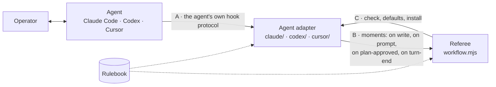
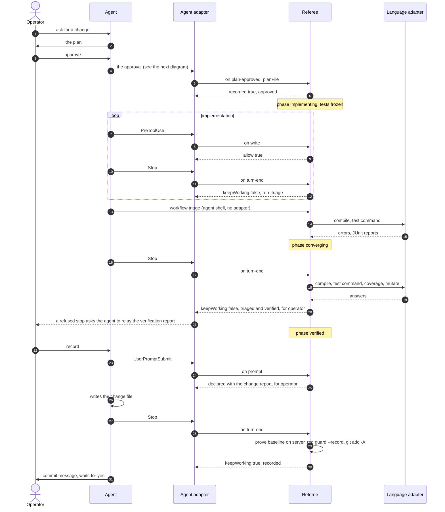
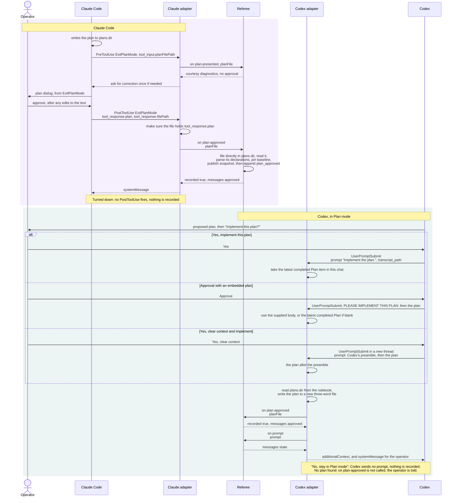

# Agent adapters

The workflow's referee runs the same for every coding agent. Everything one
agent needs lives in that agent's folder, `claude/` for Claude Code,
`codex/` for Codex and `cursor/` for Cursor, and the referee imports none of
them. The
`referee-is-agent-free` rule in `.dependency-cruiser.cjs` enforces that, and
sees through helper files too. `../adapters/README.md` is the same idea for
languages, and `../VISION.md` says where it is going.

This file is the contract between the referee and an agent adapter, as it
stands. `contract.json` beside it is the machine-readable half: every
command, with its stdin, its stdout and what no answer means, field by field.
The contract was agreed with the operator on 2026-10-23. The Codex adapter
was the proof that a second agent needs no referee edit, and the Cursor
adapter, added last, needed none either.

## The parties

| Party | What it is | Who writes it |
|---|---|---|
| **Operator** | The person. Approves plans, types `record` and `reset`, merges. | — |
| **Agent** | Claude Code, Codex or Cursor. Writes code, runs a shell, calls hooks. | Its vendor |
| **Agent adapter** | `claude/`, `codex/`, `cursor/`. Translates between the agent's hooks and the referee. Holds no workflow rules. May read the rulebook. | Us, one per agent |
| **Referee** | `../workflow/cli/workflow.mjs`. Phases, the logbook, locks, verify, the change report. | Us, once |
| **Rulebook** | `.katatay/rulebook.json`. Locked paths, the plans folder, switches, the target. The agent cannot write it. | The operator, drafted by `init` |
| **Language adapter** | Runs the tests and the compiler for the referee. Appears here only inside verify. | Us, one per language |

## Three boundaries



- **A, agent to adapter.** The vendor's hook protocol. We do not own it. The
  tables under "Mapping, per agent" list the fields each adapter reads and
  writes, as captured from real sessions.
- **B, adapter to referee: the moments.** Ours. Five commands, under "The
  moments" below.
- **C, referee to adapter.** Ours. `check` on every prompt and in
  `state show`, and `defaults` and `install` once, from `init`. No rulebook
  exists yet at that point, so `init` is told which adapter to use, and
  neither is a rulebook key.

The adapter may read the rulebook, for example for the plans folder. The
referee and the adapters are one system and change together.

### Transport, for B and C

Every call is a command started with one JSON object on stdin. It prints one
JSON object on stdout.

| Exit | Meaning |
|---|---|
| 0 | An answer. Every decision is inside it, refusals included. |
| 2 | The input does not match the contract. A bug in the caller. One sentence on stderr. |
| anything else, a timeout, or stdout that is not the promised object | No answer. The caller fails closed. |

Every request and every answer carries the harness schema version printed by
`workflow version`. Both ends check the number. A missing or unsupported
version identifies a message they cannot interpret.

The answer is written whole before the command exits. A caller reads it
through a pipe, and in Node a `process.exit` straight after
`process.stdout.write` keeps only what fit in the pipe, 64 KB on macOS. A
turn-end answer can be larger. Cut short, it is not JSON, and the adapter
fails closed on a turn whose verify passed. The same holds for what an
adapter writes back to its agent: the hooks of both adapters exit through
`leave` in their `hooks/io.mjs`, which waits for their writes.

### Reading `contract.json`

It is shaped like OpenAPI, but for commands, not HTTP: there are no paths,
methods or status codes. `transport` holds what the table above says, for
every command. Each entry under `commands` holds:

| Key | What it says |
|---|---|
| `caller` | Who starts the command: the agent adapter, or the referee |
| `run` | How it is started |
| `stdin`, `stdout` | The schema of the JSON object read and the one printed, as references into `schemas` |
| `stdoutMeans` | What the answer decides |
| `ifNoAnswer` | What the caller does on exit codes other than 0 and 2, a timeout, or stdout that does not match |
| `examples` | Sample stdin and stdout, each valid against its schema |

`schemas` are JSON Schema 2020-12. The `Code` schema carries `meanings`: one
line per code, the same as the table under "The codes".

It is JSON rather than YAML because a contract is not code, and coverage
tools leave JSON out of what they measure where they would read YAML as a
file nothing tests.

## One answer shape

Every moment answers with a decision, if the moment has one, and a list of
messages:

```json
{
  "version": 1,
  "allow": false,
  "messages": [
    { "code": "needs_plan", "for": "agent", "text": "No plan has been approved on this branch, so…" }
  ]
}
```

- `for` is `agent` or `operator`. **The agent sees every message.** `operator`
  means the operator must see it too. How that happens is the adapter's
  choice. Claude's adapter refuses a stop and has Claude repeat the reports
  the operator most needs. Codex posts triage immediately in chat. On a
  fresh verification, its Stop hook refuses the stop and asks Codex to post
  the referee’s report and warnings verbatim. If Codex skipped the triage
  reply, the referee includes triage in that report.
  Other operator messages can use `systemMessage`. `for` is a string
  rather than a boolean, so a third audience can be added later.
- `code` is one of the codes below, in `../workflow/moments/messages.mjs`. An
  adapter may branch on it, for example to add its agent's words for
  presenting a plan. **An adapter that gets a code it does not know shows the
  text as it is.** So adding a code breaks nothing.
- `text` is Markdown: paragraphs, lists and inline code. It uses no agent's
  vocabulary. An adapter may pass it through unchanged.
- The list's order is the order to show it in. Messages never decide
  anything: only the decision field does.
- There is no structured data on messages for now. An optional `data` object
  for one code can be added when an adapter needs it.

| Moment | Decision field |
|---|---|
| `on write` | `allow: boolean` |
| `on prompt` | none |
| `on plan-presented` | `needsCorrection: boolean` |
| `on plan-approved` | `recorded: boolean` |
| `on turn-end` | `keepWorking: boolean`, true means the agent has more work to do and the turn may not end yet |

### The codes

One list for every moment. A code names a situation that someone handles
differently. Two outcomes that call for the same action share a code, and the
text tells them apart.

| Code | Moments | What the agent or operator does |
|---|---|---|
| `state` | prompt | Nothing. Where the change stands, on every prompt |
| `info` | prompt, plan-approved, turn-end | Nothing. News: the baseline moved, a fallback baseline, the server did not answer and it will be retried |
| `warning` | all | The operator judges it: inherited work on the branch, code changed in a test-only change, edits with no plan, the agent's setup |
| `stop` | all | Stop and tell the operator. Only they can fix it: a broken logbook, no rulebook, an unreadable state, a baseline not on the target, staging failed, a missing plan file, the referee failed |
| `needs_plan` | write | Present a plan. The adapter adds its agent's words |
| `locked` | write | Leave the file alone: a locked path, or a delete under the requirements folder |
| `approved` | plan-approved | Start implementing. Covers a revised plan and approved requirement changes |
| `refused` | plan-approved, turn-end | Fix the plan or the branch, then present it again |
| `reset` | prompt | Nothing. A new epoch started |
| `declared` | prompt | Write the change file. Carries the change report. On a `record` repeated on a declared tree, it repeats the report and what is still to do |
| `held` | prompt | Nothing. The operator types `record` again to declare |
| `not_declared` | prompt | Tell the operator verification or its requested checks analysis is missing |
| `frozen` | turn-end | Unwind the test edits, then run triage |
| `run_triage` | plan-approved, turn-end | Run triage: now for a test-only change, otherwise when the implementation is done |
| `triaged` | turn-end | Repeat the buckets to the operator |
| `verify_failed` | turn-end | For the operator: the failure summary, to repeat verbatim. The agent's note with the output's tail follows as `info`. Check the failure. An implementation fix after triage needs a revised plan |
| `verified` | turn-end | Deliver the report in full and follow the accompanying analysis instructions on a fresh pass. Covers coverage, mutation and review areas, and the later reminders |
| `change_file` | turn-end | Write or fix the change file |
| `recorded` | prompt, turn-end | Write the commit message and wait for the operator's yes. Carries the change summary. On the prompt, it answers a `record` repeated on a recorded tree. The adapter names its commit skill |

**The referee's text uses no agent's words, so the adapter adds them.** The
referee says "present a plan" and "write the commit message". Each adapter
adds how, in one table keyed by code and audience: `CLAUDE_WORDS` in
`claude/hooks/translate.mjs` names `EnterPlanMode` and `ExitPlanMode`,
`CODEX_WORDS` in `codex/hooks/translate.mjs` names Plan mode and the
`<proposed_plan>` block, and both name the `commit-message` skill for
`recorded`. Every other message is shown as the referee wrote it.
`../workflow/agent-free.test.mjs` fails when the referee's code names an
agent's tools.

## `check`

Asked on every prompt, at a verified turn end, and by `state show` and
`state verify`. Each named adapter has a command under
`agent.adapters.<name>.checkCommand`. It reads one JSON object on stdin:

```json
{ "version": 1, "root": "/absolute/repository", "extraHooks": { "acknowledged": [{ "event": "PreToolUse", "matcher": "Bash", "command": "rtk hook claude" }] } }
```

For a linked worktree, Codex may load project hooks from the main checkout.
The Codex check recognizes either checkout’s project hook file. When Codex
uses the main file, the check reports if the worktree copy differs or cannot
be read. With exactly `CI=true`, the adapter reports that it skipped its live
Codex query. A local session still checks whether each hook is enabled and trusted.

`extraHooks` contains only this adapter's acknowledgements as the referee read
them from `agent.adapters.<name>.extraHooks`, or
`null` when the rulebook switches that check off. Off silences only the list
of extra hooks: missing and switched-off workflow hooks are still warned
about. The referee validates every adapter’s settings when it reads the rulebook.
If any value is invalid, it reports the field and stops before starting a setup check. The command prints one JSON object on stdout and exits 0:

```json
{ "version": 1, "warnings": ["a sentence for the operator", "another"] }
```

An empty list means nothing is wrong. Each warning says what is wrong and what
it means, because the operator reads it with no other context. The moments
pass each one on as a `warning` message for the operator.

- **Claude Code** (`claude/check.mjs`) reads the settings files: a workflow
  hook missing from `.claude/settings.json`, a hook another settings file or
  a skill's frontmatter adds (it could answer the plan dialog),
  `disableAllHooks`, Claude's `plansDirectory` differing from the rulebook's
  `plans.dir`, an `env` entry such as `CI` that changes what the referee
  does, and `.claude/rules/workflow.md` missing.
- **Codex** (`codex/check.mjs`) asks Codex itself, through a fresh
  `codex app-server`: `hooks/list` gives every hook from every layer (user,
  project, plugin, managed) with whether it is enabled and trusted, and
  `config/read` the settings after every layer is merged. It warns about a
  workflow hook that is missing, disabled, or not trusted (Codex skips a hook
  until the operator trusts it in `/hooks`, and again whenever it changes),
  `[features] hooks = false`, `allow_managed_hooks_only`, a hook from any
  layer that is not the workflow's own, whatever Codex itself reports about
  its hooks, and `AGENTS.md` missing. A Codex that cannot be started or does
  not answer within 10 seconds is one warning saying nothing is known.
- **Cursor** (`cursor/check.mjs`) reads the hooks files, because Cursor has
  nothing a check could ask: the project's `.cursor/hooks.json`, the user's
  `~/.cursor/hooks.json` and the enterprise file for the platform. It warns
  about a workflow hook that is missing, has a matcher that misses `Write`,
  `Delete` or `Shell`, lacks `failClosed`, has a short timeout or a
  `loop_limit`, about any hook that is not the workflow's own (a stop,
  subagent-stop or prompt hook as able to send Build's approval), and about
  `.cursor/rules/workflow.mdc` missing. Team and plugin hooks are in no file
  it can read, so it cannot see them.

  Codex keeps hook trust in `config.toml` as
  `[hooks.state."<hooks.json path>:<event>:<group>:<handler>"]` with a
  `trusted_hash`. The adapter does not read it or recompute the hash: Codex
  answers with each hook's `trustStatus`, and how it hashes is Codex's to
  change.

A setup without the instructions is incomplete, as one without the hooks is:
the agent would meet each rule only when it was refused. Only the file's
existence is checked, since its text is the project's to reword.

Warnings never fail anything. Only the operator can repair the agent's
configuration, and a red check would block the change that noticed. A command
that crashes, runs past 30 seconds, answers another version or prints anything
else gives no answer, and the referee turns that into one more warning
(`../workflow/agent.mjs`). Silence is never read as a pass. A request that does
not match is refused with exit 2.

An absent or empty `agent.adapters` map means no checks. Every listed adapter
requires a nonblank check command. Names are configuration labels; the referee
has no agent-specific routing. It runs the checks sequentially in the map's
entry order, with the same 30-second timeout for each. A failed check does not
prevent the next check. Every warning is prefixed with its configured agent
name; identical warnings from different agents are both kept.

Each adapter has its own extra-hook switch and acknowledgements. A signature
acknowledged for one agent remains reportable by another. `state show` names
each agent whose extra-hook check is disabled. The former shared
`agent.commands`, `agent.extraHooks` and `agent.acknowledgedHooks` keys are
invalid, even alongside an adapter map.

## `defaults`

What `init` should propose for this agent. `init` runs before any rulebook
exists, so it cannot find the command there: it is told which adapter to use
and starts the adapter's `defaults` command itself
(`node src/agents/claude/defaults.mjs`,
`node src/agents/codex/defaults.mjs` or `node src/agents/cursor/defaults.mjs`). It runs in the project root, and
reads:

```json
{ "version": 1 }
```

and prints:

```json
{
  "version": 1,
  "locked": [".claude/settings.json", ".claude/settings.local.json", ".claude/hooks/**", "~/.claude/settings.json"],
  "plansFolder": "~/.claude/plans",
  "instructions": ".claude/rules/workflow.md",
  "commands": { "check": "node src/agents/claude/check.mjs", "install": "node src/agents/claude/install.mjs" },
  "registration": { "file": ".claude/settings.json", "text": "{ \"hooks\": … }", "steps": ["…"] }
}
```

- `locked` becomes the rulebook's `agent.lockedPaths`: the agent's own config, as
  globs, with `~` for the home directory. A repository worked on by both
  agents lists both, so neither agent's session can switch off the other's
  hooks.
- `plansFolder` becomes `plans.dir`. Claude's is always `~/.claude/plans`,
  never the `plansDirectory` its settings name: the local settings file is
  git-ignored and a session can write it, so a proposal read from it could be
  steered by a file nobody reviews. `check` warns when the two differ. Codex
  keeps no plan files, so its adapter writes one into whatever folder the
  rulebook names, and proposes `~/.codex/plans`. Cursor's adapter proposes
  `~/.cursor/katatay-plans`, because Cursor's own `~/.cursor/plans` is locked
  and its files open with frontmatter the referee refuses.
- `instructions` is the file the agent reads the workflow's instructions
  from. `install` writes it, and `check` warns when it is missing.
- `commands.check` becomes `agent.adapters.<name>.checkCommand`, under the label chosen
  for that adapter, so `init` needs to know no adapter's command lines itself.
  Give each entry its own `extraHooks` settings; omitted settings default to
  checking with nothing acknowledged. Locks remain shared, and setup offers the first adapter’s proposal for the shared `plans.dir`. The operator can supply another path.
- `registration` is the agent's hook registration: the file, the hooks it
  holds, and the steps only the operator can take. `init` writes the file
  from the `install` answer's `registration`, merged into what the project
  already has, and prints the steps. It is the one locked file `init` writes,
  because the operator runs `init`. Each adapter builds the hooks from
  `EXPECTED` in its `registration.mjs`, the list its `check` measures
  against, so the registration proposed is one `check` finds nothing wrong
  with.
- The command lines name the adapter's scripts from the project root when
  the harness sits inside the project, as in the repository it is built in,
  and by absolute path otherwise. A project set up from a harness that lives
  elsewhere has no `src/` of its own. Each `check` accepts its own hooks in
  either form, and only exactly those paths, so a look-alike script in
  another folder is still reported.

Nothing reads the answer after `init`: from then on the rulebook is the
operator's. The referee reads it with `agentDefaults` in `../workflow/agent.mjs`,
under the same rules as `check`: a crash, a timeout, another version or a
missing field is no answer, and no answer gives no proposal at all rather than
half of one. A request that does not match is refused with exit 2.

`workflow defaults node src/agents/claude/defaults.mjs` shows Claude's
answer for a person to read, through the same check: `workflow.mjs defaults <command line>`, in
`../workflow/cli/defaults.mjs`, takes any adapter's command and writes
nothing.

## `install`

`init` also asks the adapter what to install for its agent: the workflow's
instructions and the harness support skills, in the agent's format and
location, and its hook registration. It finds the command in the defaults
answer, under `commands.install`. It runs in the project root, and reads:

```json
{
  "version": 1,
  "instructions": "# The workflow\n…",
  "skills": [{ "name": "plan-change", "description": "…", "prompt": "# Planning a change\n…" }],
  "plansFolder": "~/.katatay/plans"
}
```

and prints:

```json
{
  "version": 1,
  "files": [
    { "path": ".claude/rules/workflow.md", "text": "…" },
    { "path": ".claude/skills/plan-change/SKILL.md", "text": "…" }
  ],
  "registration": { "path": ".claude/settings.json", "text": "{ \"hooks\": … }" }
}
```

- The texts come in the request, read by the referee from
  `../workflow/INSTRUCTIONS.md` and `../workflow/skills/` with `installRequest`
  in `../workflow/install.mjs`. A project has no copy of the harness, so the
  adapter reads none of its files, and nothing it installs points into
  `src/`.
- The referee's prompts are a starting point. The adapter may reword them as it
  wishes, and so may an agent that runs `init` from its own interface. Both
  adapters add a section in their agent's words to the instructions, and to
  the skills where their `SKILL_WORDS` has some.
- `files` are paths from the project root, each with its whole text. `init`
  writes them and never overwrites one. A file marked `"shared": true` holds
  the project's own text too, as Codex's `AGENTS.md` does. `init` writes the
  workflow's part of it between two marker lines, and appends that part to a
  file that exists. A file that already has the markers is left alone.
- `registration` is the hook registration file, whole: the adapter reads
  the project's file, keeps every key in it, and adds each workflow hook
  whose script nothing runs yet. Its path must be the defaults'
  `registration.file`. Claude's also sets `plansDirectory` when the plans
  folder is inside the project; Claude Code ignores one outside it.
- `plansFolder` is the rulebook's plans folder, for an agent whose own
  settings name where plans go.
- When the harness lives outside the project, the referee adds one sentence
  to the instructions it sends, saying how `workflow` is started there.
- **Claude Code** gets `.claude/rules/workflow.md`, which it loads without
  any reference from `CLAUDE.md`, so `CLAUDE.md` stays the project's own, and
  `.claude/skills/<name>/SKILL.md`.
- **Codex** gets `AGENTS.md` and `.agents/skills/<name>/SKILL.md`. Codex has no
  folder of rules, so the workflow's text and the project's own share
  `AGENTS.md`. A project that keeps its own instructions in `CLAUDE.md` can
  add one line to it pointing there, because Codex does not read that file by
  itself.
- **Cursor** gets `.cursor/rules/workflow.mdc`, a rule with
  `alwaysApply: true`, and `.cursor/skills/<name>/SKILL.md`. Cursor also
  reads `AGENTS.md`, so a project set up for Codex too gives it Codex's
  section as well.

The referee reads the answer with `agentInstall` in `../workflow/agent.mjs`,
under the same rules as `defaults`. It also refuses a path that is absolute,
that leaves the project, or that a lock covers: the referee's own, or the
agent's `locked` from its defaults. `init` writes these files, so an answer
naming `.git/hooks/pre-commit` would otherwise have it write what no session
may.

## The moments: `workflow.mjs on <moment>`

A moment is a point where the agent hands control to the workflow. The adapter
turns what its agent sent into the input, starts the command with that JSON on
stdin, and turns the JSON it prints back into what its agent expects. They are
called moments and not events, because an event is an entry in the workflow
logbook.

| Moment | In | Decision | Codes |
|---|---|---|---|
| `on write`: before a tool call that may write | `{ version, writes: [{ path, delete }], command }` | `allow` | `locked`, `needs_plan`, `stop` |
| `on prompt`: the operator sent a message | `{ version, prompt }` | none | `reset`, `declared`, `held`, `not_declared`, `recorded`, `info`, `warning`, `stop`, and `state` last |
| `on plan-presented`: before presenting a plan | `{ version, planFile }` | `needsCorrection` | `refused`, `warning`, `stop` |
| `on plan-approved`: the operator approved a plan | `{ version, planFile }` | `recorded` | `approved`, `info`, `warning`, `run_triage`, `refused`, `stop` |
| `on turn-end`: the agent's turn ended | `{ version, stopRefusedBefore, secondsLeft, planFile?, triageReplyId? }` | `keepWorking` | `refused`, `stop`, `warning`, `frozen`, `run_triage`, `triaged`, `verify_failed`, `verified`, `change_file`, `info`, `recorded` |

`on prompt`'s last message is always `state`, except when the state cannot be
read at all: then the answer is one `stop`.

What the adapter has to work out, because only it knows its agent:

- `writes`: every file the call writes, moves or removes, absolute or from
  the repository root, with `delete` true for a removal. Empty for a shell
  call. A Claude edit names one file and never deletes. A Codex patch names
  one or more, and a move is two: the new path, and a delete of the old one,
  because moving a requirement out of its folder deletes it there. A Cursor
  `Write` names one file, and a `Delete` one file with `delete` true.
- `command`: the shell line, as the agent sent it, or `null`.

The adapter decides nothing about the files. The referee decides, in this
order: a locked path is denied, and so is a delete under the requirements
folder (`../workflow/locks.mjs`); a file outside the repository is allowed; a
Markdown file directly in `plans.dir`, or the `followUpsFile`, is allowed
(`../workflow/places.mjs`); anything else needs an approved plan. The locks are
`.katatay/`, `.git/` and the rulebook's `agent.lockedPaths`. A shell command is read
for locks only, with rule b: denied when one of its segments names a locked
path together with a write marker (a redirect, `rm`, `mv`, `cp`, `tee`,
`truncate`, `sed -i`), or a path under the requirements folder together with
`rm`, `rmdir` or `mv`. It is never held for a plan; an edit made through the
shell is caught when the turn ends. Codex edits through the shell often (it
wrote every file through `python3` in one captured session), so for Codex
this is a common path, not an edge case.

- `planFile`: the plan the operator approved, a Markdown file directly in
  `plans.dir`. The adapter makes sure it holds the approved text, and the
  referee reads the plan from it, parses its declarations and records the
  approved snapshot reference and the hash of its contents. Approval does not run template checks
  or require a validation receipt. A file outside
  the folder, or one that cannot be read, is `stop`; a plan with invalid
  declarations is `refused`. Call `on plan-approved` only when the
  operator really did approve: the call is what grants permission to start a
  change.
- `on plan-presented` runs the same courtesy validator as turn end, without
  phase work or state writes. Claude calls it before `ExitPlanMode`. It denies
  invalid contents once per repository/session/prompt using an atomic temporary
  marker; later attempts warn. Missing identity, marker errors, unavailable
  checks and unreadable files warn and permit presentation. The marker stores
  no plan content and grants no workflow authority. The operator extends the
  existing pre-tool matcher to include `ExitPlanMode` when upgrading.
- Reapproving content whose byte hash matches the current live grant returns
  `recorded: false` with an `info` message. It preserves the phase, baseline,
  approved snapshot and test evidence.
  Changed content follows revision rules. Reset or merge ends the live grant.
- `planFile` on turn end is optional, but adapters should send it when a turn
  presents a plan. This courtesy helps the operator see problems before
  approving; approval does not depend on it. Omitted or null skips the check.
  The referee checks declarations and the six-section template, collects any
  problems, and still runs the phase-specific work. The courtesy never replaces
  the freeze check, verification, mutation or recording.
  `plans.validateFormat` defaults to true; false skips only template checks.
  Invalid contents request correction through the existing one-shot stop
  mechanism. Capture failures and unreadable or misplaced files are warnings.
  Success is silent and creates no grant or receipt. Revisions are checked
  without replacing an existing approval. Claude sends the file through `on plan-presented` before `ExitPlanMode`,
  using this same validator without running turn-end work.
- `triageReplyId`: Codex identifies the current final reply headed **Triage
  recorded**. On the freshly triaged tree the referee records
  `convergence_requested` with the triage sequence and reply hash, and asks for the approved work to continue.
  A duplicate Stop for that reply ends quietly. An ordinary completion
  runs verification even when no further edits were needed.
- `stopRefusedBefore`: whether an earlier stop in this turn was refused, by
  the referee's `keepWorking` or by the adapter delivering a message. Both
  agents call it `stop_hook_active`. It is used only to stop a turn looping:
  a stop spent delivering a report still leaves the agent one chance to fix
  a verification failure.
- `secondsLeft`: how long the agent still gives the turn end before it is
  stopped. Mutation testing starts only when that still holds the rulebook's
  whole `checks.testQuality.mutation.timeLimitSeconds`, with 20 seconds to spare. Both
  adapters read their own registered Stop timeout: 900 seconds as registered,
  and Codex's default of 600 when its file sets none.

And what the decisions mean:

- `keepWorking: true` means the agent has more work to do and the turn may not
  end yet. A pass that only has something to tell the operator, such as
  `verified`, answers `false`, and delivering it is the adapter's job.
- `recorded: false` means no approval was recorded, and edits stay as they
  were.

Input that does not match, a wrong `version` included, is refused with exit 2
and a sentence on stderr. Every decision is in the answer, so the exit code is
0 whenever there is one.

**No answer is never a pass.** When a command crashes, exits with anything
but 0, or prints something that is not the promised object (another version,
a missing decision, a message without `code`, `for` or `text`), the adapter
fails closed: every file write is denied, since which files are safe is the
referee's to say, and a shell command is allowed, so the shell is still there
to find out what broke. The prompt context says the state is unavailable, an
approval says it was not recorded, and a turn end says nothing was verified and
refuses the stop. Every adapter does this in its `hooks/translate.mjs`; Cursor's, which cannot refuse a stop, sends the failure back as a follow-up.

## Plan files

The harness knows where every plan is.

- **The folder** is the rulebook's `plans.dir`, which `init` drafts from the
  adapter's `defaults`. The operator can put it anywhere: outside the
  repository, or in a folder of its own inside it, ignored by git or not.
  **The files directly in it** are excluded from protection: writing one
  needs no plan in any phase, and inside the repository they are left out of
  the tree fingerprint, like the follow-ups file. Its subfolders are not.
  Every plan is a file directly in the folder, so nothing more is needed.
- **The approved snapshot** is published before the referee records the
  `plan_approved` event. Its `planSnapshot` names the local copy and its
  `proposal` holds the hash of the approved bytes. `state show` displays the
  snapshot and reports whether it can be read. Triage and risk read the
  predictions from those approved bytes.

The adapter makes sure the file exists and holds the plan the operator
approved. The agent does not. The adapter remembers nothing between
approvals: the logbook ties each file to its change. The referee reads the
plan from the file, never from the request. No file means no approval: the
referee answers `stop`.

- **Claude Code** writes the file itself, with the operator's dialog edits
  in it (captured on 2026-10-27). Its adapter still makes sure the file holds
  `tool_response.plan`, and writes it there when it does not. Claude Code
  keeps one plan file per session, so a revised plan overwrites the file of
  the approval before it. Each new approval keeps its own snapshot, even when
  the working path is reused.
- **Cursor** saves each plan to `~/.cursor/plans/` with frontmatter, and
  rewrites its todo statuses later. At Build its adapter finds the plan the
  transcript names, takes the saved copy's text without the frontmatter, the
  operator's editor edits included, and writes it to a new three-word file in
  `plans.dir`. At the turn end it saves a plan proposed in the turn the same
  way, for the courtesy check.
- **Codex** keeps no plan files. Its adapter reads `plans.dir` from the
  rulebook, captures the completed Plan item from the current turn at Stop,
  and sends its saved path to the referee for validation. It also saves the
  approved plan when an approval arrives. Each capture writes a new file with a random three-word name, as Claude Code names its own. Each
  approval gets a file of its own.

### Folders the rulebook must not overlap

See [AC0008](../../requirements/acceptance/AC0008__rulebook_is_checked_whole.md)
for the rules on the plans folder, follow-ups file, locks and requirements
folder, and the reason the referee checks them before any approval.

## Shell commands, not moments

The agent needs a shell. Some steps happen at a point only the agent knows, or
when someone asks, so they are commands the agent runs and not moments its
hooks report. Their output is plain text for the agent; nothing in the
contract reads it.

| Command | What it does | Who runs it |
|---|---|---|
| `triage` | Runs the suite once the implementation is complete and sorts what broke into the failures the plan predicted and the surprises, and lists the predicted tests that passed. Records `triaged` or explains the refusal. | The agent, when its implementation is done |
| `checks-analysis <seq>` | Accepts analysis for the verification and records `checks_analysis`. | The agent when requested |
| `state show` | Where the change stands and what comes next, with the agent's setup warnings | Either, any time |
| `report` | The change report the operator sees at `record` | Either, any time |
| `req lint`, `req guard`, `req trace` | The requirement checks, one at a time | The agent, while working |
| `verify` | Every check. Running it by hand proves nothing: the turn end runs it and records the result | The agent, while working |

**How triage is ensured.** Without a recorded triage there is no route from
`implementing` to `converging`, so no `verified`, no `record`, and the change
cannot be finished. The triage checks its own preconditions, tests unchanged
from the baseline and an implementation that compiles, and records only a
refusal when they fail. What is not ensured is *when* it ran: a triage of a
half-written implementation lifts the freeze early.

## Sequences

### A change from start to finish

The operator asks for a change, and the agent presents a plan. The
operator's approval starts it. While the implementation is written, every edit
passes the write check and every turn end says the tests are still frozen.
The agent runs the triage from its shell once the implementation is done.
From then on each turn end runs verify and reports. The operator's `record`
declares the change, and the turn end after the change file is written records
and stages it.



### Approving a plan

This is where the two agents differ most. Both end in the same
`on plan-approved` call with a plan file. Claude Code writes the plan file
itself, and fires a hook when the operator approves in its dialog. Codex has
neither: its "Yes" arrives as a prompt, and the adapter writes the plan into
a new file. Either way the referee reads the plan from the file, checks it and
records it. A plan the operator turns down records nothing.



Codex sends the approval as an ordinary prompt. The agent cannot send a prompt
on the operator's behalf, so the channel is still the operator's. An operator
who types an approval phrase by hand is approving the latest completed Plan
in this chat, even after discussion. A prompt beginning exactly with
`PLEASE IMPLEMENT THIS PLAN:` supplies the plan in its remaining text; a
blank body falls back to the latest completed Plan. A newer empty or malformed
Plan produces a diagnostic instead of selecting an older one. The native
clear-context handoff keeps its existing extraction. Two
things could still bend it, and both are covered. The plan is read from the
thread's transcript, so `~/.codex/sessions/**` is locked, and a session cannot
rewrite the text the operator approves. And a `Stop` hook's block reason is
sent to Codex as a new prompt, so `check` warns about any `Stop` or
`UserPromptSubmit` hook that is not the workflow's own.

## Mapping, per agent

### Claude Code

| Hook | Matcher | Moment | Fields read | Answer written |
|---|---|---|---|---|
| `PreToolUse` | `Edit\|Write\|NotebookEdit\|Bash` | `on write` | `tool_name`, `tool_input.file_path`, `tool_input.notebook_path`, `tool_input.command` | `hookSpecificOutput.permissionDecision: "deny"` + `permissionDecisionReason` |
| `PreToolUse` | `ExitPlanMode` | `on plan-presented` | `tool_input.planFilePath`, `session_id`, `prompt_id` | one correction denial, then advisory `additionalContext` and `systemMessage`; never approval |
| `PostToolUse` | `ExitPlanMode` | `on plan-approved` | `tool_response.plan`, `tool_response.filePath` | `systemMessage` |
| `UserPromptSubmit` | — | `on prompt` | `prompt` | `hookSpecificOutput.additionalContext`, `systemMessage` |
| `Stop` | — | `on turn-end` | `stop_hook_active` | `decision: "block"` + `reason`, or `systemMessage` |

Defaults, in `claude/proposal.mjs`: locked `.claude/settings.json`,
`.claude/settings.local.json`, `.claude/hooks/**`, `~/.claude/settings.json`;
plans folder `~/.claude/plans`; instructions `.claude/rules/workflow.md`;
commands `check` and `install`; the hook registrations above, in
`.claude/settings.json`.

Payloads captured on 2026-09-17 and 2026-10-27 are in `tests/fixtures/claude/`.
The pre-presentation payload cases are synthetic and based on the
[ExitPlanMode hook documentation](https://code.claude.com/docs/en/hooks#exitplanmode).

### Codex

Settled by a capture under Codex 0.155.1 on 2026-10-29, in `tests/fixtures/codex/`.

| Hook | Matcher | Moment | Fields read | Answer written |
|---|---|---|---|---|
| `PreToolUse` | `apply_patch\|Bash` | `on write` | `tool_name`, `tool_input.command` (the whole patch for `apply_patch`, a shell line for `Bash`), `cwd` | `hookSpecificOutput.permissionDecision: "deny"` + `permissionDecisionReason`, or nothing |
| `UserPromptSubmit` | — (ignored for this event) | `on plan-approved` when `prompt` is an approval, then `on prompt` | `prompt`, `transcript_path`, `permission_mode`, `cwd` | `hookSpecificOutput.additionalContext`, `systemMessage` |
| `Stop` | — (ignored for this event) | `on turn-end` | `stop_hook_active`, `cwd`, `transcript_path`, `turn_id` | `decision: "block"` + `reason`, `systemMessage`, or `{}`: Codex needs JSON here |

What the capture settled, and where it differed from what was expected:

- **The approval.** "Yes, implement this plan" sends the prompt
  `Implement the plan.`, and the plan is in the thread's transcript as an
  `event_msg` / `item_completed` item of type `Plan`, with the text in
  `item.text`. "Yes, clear context and implement" starts a new thread, whose
  transcript holds no plan: its first prompt is Codex's preamble ("A previous
  agent produced the plan below…"), a blank line, and the plan. Codex
  documents the transcript's format as not stable, so the adapter reads only
  the `Plan` item, and says so when a transcript shows a `<proposed_plan>`
  block with no `Plan` item.
- **`permission_mode` stays `default` in Plan mode**, though the docs list
  `plan`. Nothing in a payload says Plan mode is on.
- **`bypassPermissions` means approvals are off**, not the sandbox: `codex
  exec` sends it while its sandbox is `workspace-write`. The prompt hook
  warns the operator about it.
- **A patch** names its files in `*** Add File:`, `*** Update File:`,
  `*** Move to:` and `*** Delete File:` lines, several in one call, with paths
  relative to `cwd`. A patch that names none is denied.
- **The hooks start in the session's working directory**, which may be a
  subfolder. Each registered command resolves its script from the git root,
  as Codex's own examples do, and each hook moves to the git root before it
  asks the referee.
- **`PreToolUse` takes no `systemMessage`.** Codex fails a hook whose answer
  has a field its event does not support, and lets the tool call through. So
  the pre-tool hook carries a drift warning in its denial's reason, or as
  `additionalContext`.
- **`additionalContextLimit: 0`** is registered on `UserPromptSubmit`. Codex
  otherwise cuts each `additionalContext` to about 2,500 tokens and saves the
  rest to a file, and the change report at `record` is longer.

Defaults, in `codex/proposal.mjs`: locked `.codex/**`,
`~/.codex/config.toml`, `~/.codex/hooks.json` and `~/.codex/sessions/**`;
plans folder `~/.codex/plans`; instructions `AGENTS.md`; commands `check` and
`install`; the three hooks above as the registration, in `.codex/hooks.json`,
with a Stop timeout of 900. The operator then trusts the project and the three
hooks in Codex's `/hooks`. Codex's sandbox also keeps `.git` and `.codex`
read-only, which is a second layer and not a replacement: the sandbox is the
operator's to switch off.

### Cursor

Settled by a capture under Cursor 3.32.10 on 2026-11-26, in `tests/fixtures/cursor/`.

| Hook | Matcher | Moment | Fields read | Answer written |
|---|---|---|---|---|
| `preToolUse` | `Write\|Delete\|Shell`, `failClosed: true` | `on write` | `tool_name`, `tool_input.file_path`, `tool_input.command`, `workspace_roots` | `permission: "deny"` + `agent_message` and `user_message`, or `{}` |
| `beforeSubmitPrompt` | — | `on plan-approved` when `prompt` is Build's, then `on prompt` | `prompt`, `transcript_path`, `workspace_roots` | `continue: true` + `additional_context` |
| `stop` | — | `on turn-end` | `loop_count`, `transcript_path`, `workspace_roots` | `followup_message`, or `{}` |

What the capture settled, and where it differed from the documentation:

- **Edits.** Every file edit is `Write`, with the absolute `file_path` and the
  whole new `content`. A removal is `Delete`. A shell call is `Shell`, with
  `tool_input.command` and an empty `cwd`. A read is `Read`, which the matcher
  leaves out. Another edit tool would pass the gate, and the freeze check at the
  turn end would still catch its edit.
- **`{}` lets a call go on.** Every Claude Code hook Cursor ran answered `{}`
  beside the capture hook's answer, and every call went on. The pre-tool hook
  never answers `permission: "allow"`, which could answer a question Cursor
  would otherwise ask the operator.
- **Prompt context works.** The documentation lists only `continue` and
  `user_message` for `beforeSubmitPrompt`. The agent received the
  `additional_context` the capture hook answered with.
- **The approval.** `CreatePlan` reaches no hook. Build sends a prompt that
  starts `Implement the plan as specified, it is attached for your reference.`,
  with `composer_mode: "agent"` and no attachments. The transcript, as
  `{ role, message }` lines, holds the `CreatePlan` call with `name` and
  `plan`. Cursor's saved copy is `~/.cursor/plans/<slug>_<hash>.plan.md`, with
  frontmatter `name`, `overview`, `todos` and `isProject`.
- **Stop.** A `followup_message` arrives as a new prompt, through
  `beforeSubmitPrompt`, and the next `stop` has `loop_count: 1`. Nothing the
  capture found is shown to the operator, so reports go to the agent to post.
- **Claude Code's hooks.** Cursor ran each hook in `.claude/settings.json`
  beside its own, with Cursor's payload, `cursor_version` included. Claude's
  hooks answer `{}` when they see that field (`claude/hooks/cursor.mjs`).

Defaults, in `cursor/proposal.mjs`: locked `.cursor/hooks.json`,
`.cursor/hooks/**`, `~/.cursor/hooks.json`, `~/.cursor/plans/**` and
`~/.cursor/projects/**`; plans folder `~/.cursor/katatay-plans`; instructions
`.cursor/rules/workflow.mdc`; commands `check` and `install`; the three hooks
above as the registration, in `.cursor/hooks.json`, with a stop timeout of 900
and `loop_limit: null`. The operator then trusts the workspace, because Cursor
runs no project hook in an untrusted one.

## What is in each adapter

| Path | What it is |
|---|---|
| `claude/hooks/` | The four scripts Claude Code runs (`pre-tool`, `post-tool`, `user-prompt`, `turn-end`), each a translator around one moment, and what they share: `referee` starts a moment and reads its answer, `translate` turns the answer into Claude Code's output and fails closed without one, `io` reads the payload and writes the answer, `drift` notices when Claude Code stops sending a field, `runaway` refuses a hook started by a test against this repository |
| `claude/settings.mjs`, `claude/registration.mjs` | Which hooks the settings must register, what the settings Claude Code actually applies add or switch off, where Claude Code puts plans, and whether the workflow's instructions are installed, for the check's warnings |
| `codex/hooks/` | The three scripts Codex runs (`pre-tool`, `user-prompt`, `turn-end`), and the same helpers as Claude's, in Codex's shapes. `io` also moves a hook to the git root |
| `codex/patch.mjs` | The files a patch writes, from its headers |
| `codex/approval.mjs` | The supported approval prompts, the plan in a transcript or a prompt, the new plan file, and recording the approval |
| `codex/app-server.mjs`, `codex/setup.mjs`, `codex/registration.mjs` | Asking Codex's app server, turning its answers into the check's warnings, and the hooks the workflow registers |
| `cursor/hooks/` | The three scripts Cursor runs (`pre-tool`, `user-prompt`, `turn-end`), and the same helpers as Codex's, in Cursor's shapes |
| `cursor/approval.mjs`, `cursor/transcript.mjs`, `cursor/plans.mjs` | Build's prompt, the plan in a transcript and in Cursor's saved copy, the new plan file, and the plan captured at the turn end |
| `cursor/setup.mjs`, `cursor/registration.mjs` | Reading the hooks files into the check's warnings, and the hooks the workflow registers |
| `claude/hooks/cursor.mjs` | Whether Cursor started a Claude Code hook, which then answers nothing |
| `*/check.mjs` | The `check` command |
| `*/defaults.mjs`, `*/proposal.mjs` | The `defaults` command, and the proposal it prints, as a plain function so tests run it in process |
| `*/install.mjs`, `*/install-files.mjs` | The `install` command, and the files it answers, as a plain function |

The payloads captured from live sessions, with the README on recapturing
them, are test fixtures: `tests/fixtures/claude/`, `tests/fixtures/codex/` and
`tests/fixtures/cursor/`.

Each adapter stands alone, and copies the little plumbing it shares with the
other instead of importing it. Each is meant to ship on its own, and their
agents' output shapes differ. The hooks hold no workflow rules: the
`hooks-talk-through-commands` rule in `.dependency-cruiser.cjs` stops the
hooks of any adapter importing the referee. What a hook decides sits in a
plain function, tested in process, because a hook script runs in a process of
its own where coverage cannot see it.

Everything the hooks used to decide is in the referee, under
`../workflow/moments/`, with the decisions it calls on:
`../workflow/locks.mjs` (which files no call may write),
`../workflow/hooks/gate.mjs` (may this edit happen in this phase) and
`operator.mjs` (the operator's two words, and the plan excerpt).

## Locks

The referee decides every lock, and no file in `claude/`, `codex/` or `cursor/` is
locked. Each agent's own settings and hooks are, through the rulebook's
`agent.lockedPaths`. The lock code itself, `../workflow/locks.mjs`, is as editable
as the rest of `src/`. The Claude
path-protection hook once locked itself, and that was given up for one lock
list every agent shares. `src/` is not on the rulebook's high-risk list,
because nearly every change edits it, so only a reviewer reading the diff sees
an edit to the lock code. A person can edit anything, which is how a deadlock is
broken.

## Decisions

The decisions about the agent contract are in the catalogue, each in its
requirement's `## Why`: locks, the follow-ups file and triage in
[AC0017](../../requirements/acceptance/AC0017__open_phase_gate.md),
[AC0020](../../requirements/acceptance/AC0020__agent_locked_paths.md),
[AC0021](../../requirements/acceptance/AC0021__shell_lock_check.md) and
[AC0024](../../requirements/acceptance/AC0024__triage_records_the_run.md);
the moments, versions and messages in
[AC0066](../../requirements/acceptance/AC0066__moment_contract.md);
adapter actions and skills in
[AC0067](../../requirements/acceptance/AC0067__ktty_agent.md);
the gate without a referee answer in
[AC0068](../../requirements/acceptance/AC0068__claude_prompt_and_pre_tool.md);
`keepWorking`, `stopRefusedBefore` and relaying a pass in
[AC0069](../../requirements/acceptance/AC0069__claude_plan_and_stop.md);
what an adapter cannot guarantee in
[AC0071](../../requirements/acceptance/AC0071__agent_check_warnings.md);
and the extra-hook switch in
[AC0072](../../requirements/acceptance/AC0072__agent_warnings_delivered.md).

The [approval criteria](../../requirements/acceptance/AC0014__approval_event.md)
describe the file handed over. [AC0013](../../requirements/acceptance/AC0013__approval_refusals.md)
covers missing plans and [AC0008](../../requirements/acceptance/AC0008__rulebook_is_checked_whole.md)
covers a plans folder or follow-ups file that overlaps a lock.
