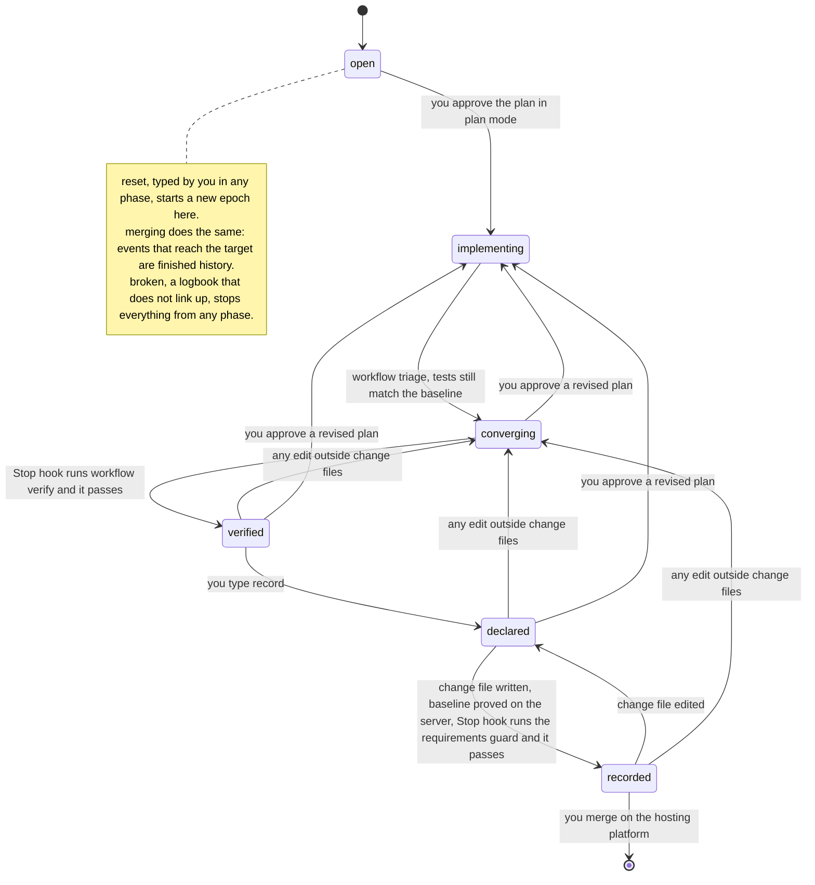

# The workflow machine

`INSTRUCTIONS.md` beside this file describes the workflow and the phases, in
words any agent can follow. An agent adapter installs it into a project with
the harness support skills in `skills/` (see `install.mjs`); for Claude Code it
lands in `.claude/rules/workflow.md`. This file is the operator's
reference for the parts that are not the agent's business: what is registered
where, and what you can say to the machine.

A plan sets out the behavior and predicts which tests will fail. Freezing the
baseline tests until triage lets the operator see where the implementation
differed from that prediction. Verification then measures the finished change.
The branch logbook ties both decisions and their evidence to the same approval.
Language adapters supply measurements and agent adapters deliver the referee’s
decisions through hooks.

## Setting up a project

Start at the root of a Git repository. Run `ktty init --questions` to see the
question IDs and defaults. In a terminal, Enter accepts the default. For an
unattended setup, supply one JSON object on stdin or with `--answers <file>`.
Use `--project <dir>` to select another project.

The setup criteria cover [locating the adapters](../../requirements/acceptance/AC0002__ktty_path.md),
[proving the commands](../../requirements/acceptance/AC0004__ktty_init_proves_before_writing.md),
[preserving existing files](../../requirements/acceptance/AC0005__ktty_init_keeps_existing_files.md),
[the questions](../../requirements/acceptance/AC0006__ktty_init_questions.md)
and [the probe](../../requirements/acceptance/AC0007__ktty_init_probe.md).
For [invalid command arguments](../../requirements/acceptance/AC0003__ktty_unknown_command.md),
`ktty` prints the correct invocation and help hint on stderr and exits 2.

The questions cover the target branch, the test, test support and code globs,
the test run and its reports, compile, the plans folder, the follow-ups file,
the requirements folder, high-risk areas, coverage, mutation, the other
checks and the wrapper files. The plans
folder defaults to the first agent's proposal, because Claude Code writes
plans to `~/.claude/plans` and ignores a `plansDirectory` outside the
project. Codex proposes `~/.codex/plans`. Without a proposal the example
and fallback are `~/.katatay/plans`. The default requirements folder is
`requirements`.

The two questions asked last have defaults, so an answers file written before
they existed still reads:

- `checks.codeQuality` holds the other checks verify runs, such as a lint or
  the build, by name. In a terminal, one per line:
  `lint | make lint | 0=clean, 1=findings`. In JSON, the same object the
  rulebook holds, so `onFailure`, `runs`, `timeLimitSeconds` and
  `suppressions` can be given there. The rulebook gets `checks.codeQuality`
  only when there is at least one check.
- `wrappers` lists the files written to make a tool keep the adapter
  contract, such as a test reporter or a mutation wrapper. Each must exist.
  `init` lists them as one high-risk area, because a wrapper decides what the
  referee sees of a tool's run.

Every piece of such glue lands in the project's own repository: a wrapper, a
shim, a reporter plugin, a converter script, a tool's config file. It is
committed with the project and reviewed like the rest of its code. Nothing is
written into the harness, the operator's home folder or anywhere else on the
machine, and the harness ships no adapter per language. So the project works
the same on every machine that clones it, and the operator can read every
line that decides what a check reports. `init` refuses a `wrappers` path that
is absolute, holds `..`, or names a symbolic link anywhere below the project
root, even if the link points inside the project.

### The probe

The setup probe runs each drafted command in verification order. It reads
the results and stops at the first failed item.

| Item | Passes when |
|---|---|
| Repository | The folder is a git repository's root. The probe tells the project's files from ignored output by asking git, so without one `init` refuses and says to run `git init`. |
| Compile | The command exits with a code listed as `clean` and the pattern finds no error. Left out when `code.compile` is `"none"`. |
| Test run | The reports parse, cover every file matched by `tests.paths.all`, and contain at least one passing test and no failures. Git ignores the reports. When some tests are skipped, the probe prints both the passed and skipped counts. |
| Coverage | The command prints LCOV that parses, every code file under a measured folder is in it, and every folder meets its minimum. Left out when coverage is `"none"`. |
| Mutation | Given the tested module named by `--scratch-module <file>` and the configured time limit, the command exits 0 or 1, prints text, and writes a fresh report that parses. Survivors are counted. Exit 2, a run that checked nothing, fails. Left out when mutation is `"none"`. |
| Every other check | It exits with a code listed as `clean`, or as `findings` when its `onFailure` is `report`. `{changedFiles}` becomes every file git knows and `{baseline}` becomes `HEAD`, because a project being set up has no change to measure yet. |

Use `ktty init --probe` to see each item before installing. It tests the
existing rulebook when one exists, or the draft otherwise. An ordinary
repeat init keeps the existing rulebook.

When the probe runs mutation, give the project-relative path of the tested
scratch module, or the hello-world module in a new project. Git must track
the file or be able to track it. The file must be eligible for mutation.
Pass the same option to fresh `init`, whose automatic probe also needs the
file. Keep the module and its test until the last probe finishes.

`init --probe --expect <state>` proves the opposite, that the commands can
fail. A command that always exits 0 passes every item above. So whoever sets
the project up breaks one thing, and the probe passes only when it sees that
break, at the item concerned, and stops there.

| State | The probe must see |
|---|---|
| `compile-error-in-code` | The pattern reads at least one error in a file that is not a test. |
| `compile-error-in-test` | The pattern reads at least one error, and every one is in a test file. |
| `failing-test` | Compile clean, every test file in the report, and at least one failed test. |
| `below-minimum` | Compile and the test run pass, the LCOV is complete, and at least one folder is below its minimum. |
| `survivors` | Everything up to coverage passing, the mutation command exiting 1, and its report listing a confirmed survivor in the scratch module. |

A state whose item is switched off is refused with exit 2. `--expect` without
`--probe` is refused too: a rulebook is never written on a planted break. The
other checks have no failing state, because what a lint or a build objects to
is the tool's own business.

The [setup skill](../adapters/skills/ktty-init.md) guides the interview
and the probe runs. Use the results to review the draft before installation.

With coverage on, give at least one folder ending in / and a minimum for both
lines and branches. In a terminal, enter one row per folder, such as
`src/ 80 70`, then a blank line. An initial blank asks again. In JSON,
`coverage.minimum` takes the same rows as a map of folders to
`{ "lines": 80, "branches": 70 }`. With coverage off, setup skips the
question and writes `"coverage": "none"`. With mutation on, the proposed time
limit is 300 seconds. The question IDs in `--questions` are the names for
answers to setup. For example, the answer to `mutation.report` becomes
`checks.testQuality.mutation.output` in the rulebook.

After the probe passes, init writes the rulebook, requirements templates,
local evidence ignore rule and agent files. Review the rulebook, configure
its Git remote, trust the hooks where prompted, and commit and push the setup
to the target so the first approval has a baseline.

## The phases

Below is who moves each transition. Everything on an arrow is either you, or a
hook running something itself. None of it is the session saying it did. The
catalogue holds the rules: [how the phase is worked out](../../requirements/acceptance/AC0016__phase_from_logbook.md),
[what `open` allows](../../requirements/acceptance/AC0017__open_phase_gate.md),
[what an unreadable state allows](../../requirements/acceptance/AC0018__unreadable_state_fails_closed.md),
and the two freezes, [of the tests](../../requirements/acceptance/AC0022__tests_frozen_while_implementing.md)
and [of the implementation](../../requirements/acceptance/AC0023__implementation_frozen_after_triage.md).
Triage is in [AC0024](../../requirements/acceptance/AC0024__triage_records_the_run.md)
to [AC0029](../../requirements/acceptance/AC0029__req_risk.md). The
[triage event schema](../schemas/triaged.schema.json) and the
[refusal event schema](../schemas/triage-refused.schema.json) describe what it
writes.



Use `state show` to see the phase and whether Git holds the events. Use
`state verify` to check every logbook against its chain, Git and the target.
Both commands identify the file that broke the chain. See
[logbook integrity](../../requirements/acceptance/AC0053__broken_logbook.md),
[state verify](../../requirements/acceptance/AC0054__state_verify.md) and
[state show](../../requirements/acceptance/AC0055__state_show.md).

The referee's own JSON is strict on write and lenient on read. Appending an
event refuses any field its format does not list, because that is a typo in a
writer. Reading a stored event ignores such a field, in the envelope and in
the payload. Required fields are still required and checked, and every check
across fields still runs. Events are committed and never rewritten, so without
this a field dropped from a format would break every logbook that still holds
it, and the format would have to keep it forever as a legacy field. Ignoring
it is safe: the hash chain covers every byte of an event, unknown fields
included, and a field no code reads cannot grant progress. The snapshots an
event names (the test analysis, coverage analysis and mutation findings)
follow the same rule: their writers refuse an unknown field, their readers
ignore it. `json-fields.mjs` holds the check and the read mode.

Adapter input stays strict. The rulebook's sections, the language adapter's
contract included, refuse an unknown key with its path and the allowed keys.

A merge finishes the epoch. Reusing that branch name requires a fresh approval.
Before the merge, editing a recorded change returns it to `converging`.
See [merged events and branch reuse](../../requirements/acceptance/AC0057__merged_events_grant_nothing.md).

## What a fresh checkout can learn

A checkout with committed events and change files has the history under
`.katatay/state/`. By default Git ignores the snapshots under
`.katatay/local/`. The following v1 fields can be read from the events alone.

| Decision | What the committed logbook keeps |
|---|---|
| Approval and baseline | `plan_approved` records when the operator approved, the plan hash (`proposal`), the snapshot path, test-only flag, approved requirement changes and baseline commit. Each `baseline_moved` gives the old and new commits. The approval message is where the operator learns whether the server answered. |
| Triage | `triaged` gives the tree and implementation fingerprints, whether there were implementation changes, the risk level, its reasons, the test and prediction counts and any unchecked items. A recorded `triage_refused` gives the reason and the affected files, failures or diagnostic where applicable. `convergence_requested` identifies the triage sequence and the reply hash for a continuation. |
| Plan revision | `workflow replan` writes `replan_requested` with the current approval sequence. Verification waits across planning turns. Approving a changed plan replaces the approval. Choosing the original plan and running `workflow replan --resume` writes `replan_resumed` with the request sequence. A recorded change requires a merge or operator reset before a revision. |
| Verification | Both outcomes record the tree fingerprint, baseline, rulebook fingerprint and ordered per-check results. These include statuses, reasons where applicable, test totals, coverage against each folder’s targets, mutation counts and ordinary check outcomes. A pass also records the implementation and test fingerprints. A failure keeps the last 20 lines of output and may lack a readable rulebook hash. |
| Analysis and recording | `checks_analysis` links a verification sequence to the first 2,000 Unicode code points of its analysis summary. A hold and a declaration keep the tree, operator note, gap counts and report reference. The declaration also keeps the summary lines. `recorded` names the change files and fingerprints their contents. A reset can list the change files it abandoned. |

On the change’s named branch before merge, the referee folds the events and
checks the current tree to recover its phase. A matching recorded change
therefore reads as `recorded`. With a detached HEAD the referee looks for
the logbook named `HEAD`, ordinarily finds none and reports `open`. Once the
target contains the change’s events, they grant no phase on a reused branch.
`workflow state verify` can still check the chain, compare committed events
with Git and check baseline proof. The guard can compare the change file’s
report with the committed declaration summary.

To measure the code again, start a working branch at the recorded baseline.
Reapply the implementation with the baseline tests, triage under a new
approval, then restore the final tests and verify. Compare the test results,
uncovered touched lines and mutation findings with the headline counts in the
committed events. The approved plan and its exact predictions live in the
original plan snapshot. Without them a new run cannot reconstruct which
failures the operator saw classed as surprises or reproduce the original risk
calculation.

The snapshot references also identify the original test names, detailed
diagnostics, uncovered line numbers, survivor identities, full analysis and
full change report. Recovering those exact artifacts requires their original
bytes. A second run can produce different timings in JUnit or exercise
different mutants within the time budget. Matching counts cannot prove what
the operator saw. A regenerated artifact matches a snapshot digest only when
every byte matches.

## The rulebook

Run `workflow version` to print the harness schema version, even outside a
project. Its source is `HARNESS_SCHEMA_VERSION` in `src/schema-version.mjs`.
Raise it for a breaking change to a harness schema, such as removing or
renaming a field. The rulebook, logbook events, agent protocol requests and
replies, and documents the harness builds record this number as `version`.

Local documents with this field are test analysis, coverage analysis, mutation
findings, saved check results, triage snapshots and change reports. Tool
reports, printed output, the approved plan and the agent’s analysis text are
kept byte for byte. Each stored event and local document must declare a
supported numeric version. Version 1 selects the part 1 format. A missing
or unsupported version identifies the affected event or snapshot.

State verification reads every logbook before checking which events merged.
Preserve historical logbook bytes and their digest links when retiring a
logbook from the target. For invalid local evidence, restore the exact files
named by the receipt or obtain fresh evidence. Fresh verification writes new
check documents when the checks execute. A once-per-plan producer can run
under a fresh approval. Fresh triage with baseline tests writes a new triage
snapshot. Older receipts still refer to their original files.

Check the [rulebook schema](../schemas/rulebook.schema.json) for the structure.
The [rulebook](../../requirements/acceptance/AC0008__rulebook_is_checked_whole.md),
[version](../../requirements/acceptance/AC0009__rulebook_version.md) and
[target](../../requirements/acceptance/AC0010__rulebook_target_branch.md)
criteria describe the checks Katatay performs when it reads these settings,
including path overlap and Git remote existence. A working example follows.

```json
{
  "version": 1,
  "targetBranch": "origin/main",
  "tests":        { "paths": { "all": ["**/*.test.*"], "acceptance": ["**/acceptance/**"], "support": [] },
                    "run": { "command": "npm test", "reportPaths": ["reports/junit/*.xml"], "tagComment": "^//" } },
  "code":         { "paths": ["src/**/*.js"], "compile": "none" },
  "agent":        { "lockedPaths": [".claude/settings.json"], "adapters": { "claude": { "checkCommand": "node src/agents/claude/check.mjs", "extraHooks": { "check": true, "acknowledged": [] } } } },
  "plans":        { "dir": "~/.katatay/plans" },
  "followUpsFile": "FOLLOW-UPS.md",
  "highRisk":     [ { "paths": ["migrations/**"], "why": "Every database runs them." } ],
  "checks":       { "testQuality": { "coverage": "none", "mutation": "none" }, "codeQuality": { "build": { "command": "make build", "exitCodes": { "0": "clean", "1": "findings" } } } },
  "requirementsDir": "requirements"
}
```

| Section | What it says |
|---|---|
| `version` | The shape of the file. This referee reads the version printed by `workflow version` and refuses any other, because a key it did not know about could be a safety setting. The field is required. |
| `targetBranch` | Required. Names a remote and branch, such as `origin/main`. Every read checks the syntax. When the workflow needs the target, it also asks Git whether the remote exists. |
| `tests` and `code` | Define test files in `tests.paths.all` and acceptance evidence in `tests.paths.acceptance`. The runner uses `tests.paths.slow` for its slow selection. The freeze includes `tests.paths.support`. `tests.run` supplies the command, JUnit `reportPaths` and the `tagComment` pattern for scenario tags above tests. `code` supplies source paths and the compile step. See `src/adapters/README.md`. |
| `agent` | Requires `lockedPaths` and at least one named adapter under `adapters`. Lock paths can be relative to the repository, relative to `~/` or absolute. Each adapter requires `checkCommand`. Its optional `extraHooks.check` defaults to true and `extraHooks.acknowledged` defaults to an empty list. Checks run in entry order and every warning names its agent. See `../agents/README.md`. |
| `plans` | `dir` is where plan files live, inside the repository or out. The Markdown files directly in it are written without a plan in every phase and, inside the repository, left out of the tree fingerprint. Its subfolders are not. `validateFormat` is an optional boolean, true by default; false disables presented-plan template checks, while YAML and declaration checks remain mandatory. |
| `followUpsFile` | The list of work parked for later, a Markdown file inside the repository, `FOLLOW-UPS.md` if absent. Writable in every phase and left out of the tree fingerprint. |
| `highRisk` | Paths the reviewer must read when changed. Triage scores prediction errors and test regressions independently. Each is `{ paths, why }`, and the `why` is what the reviewer reads. A file in two areas is listed under each. The rulebook itself is always listed, whatever this says. |
| `checks` | The `testQuality` chain must configure coverage and mutation or set each to `"none"`. The optional `codeQuality` chain holds checks such as lint and the build. See "Checks" below. |
| `requirementsDir` | The folder the requirements live in. `requirements` if absent. |

Every read validates the whole rulebook before using a setting. For example,
a malformed `highRisk` entry prevents the workflow from reading the test command.
The refusal names the field for the operator to fix. The write gate applies
its existing unreadable-rulebook rules until the file is corrected. Each process
reuses its validated rulebook while the file is unchanged.

### Checks

The catalogue holds the rules for checks: [exit codes](../../requirements/acceptance/AC0034__check_exit_codes.md),
[blocking or reporting](../../requirements/acceptance/AC0035__check_block_or_report.md),
[once-per-plan reuse](../../requirements/acceptance/AC0036__once_per_plan_checks.md)
and [the agent's analysis](../../requirements/acceptance/AC0037__checks_analysis.md).
The [check result schema](../schemas/check-result.schema.json) describes the
document a check writes to its `output`.

Each entry of a chain is a check by name. The two required test-quality entries have fixed policies. Coverage runs `always` and must `block` on failure. Mutation runs `oncePerPlan` and must `report` findings. Each accepts `"none"` to turn it off. For ordinary checks, the following fields apply. Verify runs checks after its own steps,
which compile before running tests. Coverage reads that test run, when enabled,
then mutation assesses the tests. Those two checks run in that order regardless
of their positions in the rulebook. The remaining `testQuality` checks follow,
then `codeQuality`, each in configured order. `src/workflow/checks.mjs` runs one.

```json
{ "checks": {
  "testQuality": { "coverage": "none", "mutation": "none" },
  "codeQuality": {
    "boundaries": { "command": "make boundaries", "exitCodes": { "0": "clean", "1-255": "findings" } },
    "lint": {
      "command": "eslint {changedFiles}",
      "exitCodes": { "0": "clean", "1": "findings" },
      "onFailure": "report",
      "suppressions": ["eslint-disable"]
    }
  }
} }
```

| Key | What it says |
|---|---|
| `command` | Required. `{baseline}` becomes the sha the change is measured from. `{changedFiles}` becomes every file changed since the baseline that is still on disk, each quoted for a POSIX shell. A command that names `{changedFiles}` is skipped when no file changed, because many tools given no file check the whole project. |
| `exitCodes` | Required. Each exit code, or a range such as `"1-255"`, to `clean`, `findings` or `broken`, with at least one `clean` and one `findings`. A code not listed means broken, so a crash never reads as a clean run. Ranges are for a tool such as dependency-cruiser, which exits with its number of findings. |
| `runs` | `always`, the default, or `oncePerPlan`: run until a pass under this approval, rulebook and baseline measures the check. That pass's receipt holds the run in its unified results, and later verifies skip the check, record a `reused` result pointing at that receipt, and the verified message repeats it. |
| `onFailure` | `block`, the default, or `report`. Whether findings fail verify, or are printed while verify goes on. It acts on findings only: a broken run, a run past the time limit, or a check the referee could not set up fails verify either way, because a tool that broke checked nothing. A setup error, such as no target for `{baseline}` or an output file git tracks, refuses verify as any rulebook error does. A blocking once-per-plan check runs on every verify until it comes back clean. |
| `timeLimitSeconds` | 300 if absent. Past it the run is stopped and counts as broken. |
| `skipInCi` | `false` if absent. `true` means verify does not run the check when `CI=true`: it prints `<name> — skipped in CI (skipInCi: true)`, records a skipped result and goes on. No output file is cleared and no command starts. It is independent of `runs`. Only `CI=true` counts as CI; unset, `false` and every other value are local, the rule `req guard` and the target fetch follow too (`src/workflow/ci.mjs`). Coverage refuses `true`, because enabled coverage runs on every verify. Any value that is not a boolean is refused. |
| `output` | Optional ignored, untracked destination for the completed JSON result. Coverage requires it. See the result contract below. |
| `suppressions` | Regular expressions for the comments that switch the tool off in one spot, such as `eslint-disable` or `# nosec`. A change that adds a line matching one lists the file under "Must look". Every code file counts, tests included. |

The names `coverage` and `mutation` are reserved for their respective quality checks.
The names of verify's own steps also remain reserved. Verify reports
a failure by name, so duplicate names are refused. A check's config files, such as
`.dependency-cruiser.cjs`, belong in `highRisk`, which already lists files
with a reason. For ordinary checks the referee reads the exit code and passes the text on.
Coverage has its own analysis of LCOV, described below. The verification summary lists a check that reports
findings with the first lines of what it printed, and a once-per-plan check's
reused result marked as stale, with the command that runs it again.

The optional boolean `plans.validateFormat` is checked every time the file is read.

Four gating keys are checked every time the file is read: `plans.dir`,
`followUpsFile`, `requirementsDir` and `agent.lockedPaths`. They decide what is written without a
plan, so a wrong one ungates edits everywhere at once. The referee refuses the
rulebook, and every moment and `state show` say why, when the plans folder is
the repository root, or when the plans folder or the follow-ups file overlaps a
lock: `.katatay/`, `.git/`, an `agent.lockedPaths` entry, or the requirements
folder. A plans folder above the repository is fine, because only the files
directly in it are exempt. See "Folders the rulebook must not overlap" in
`../agents/README.md`.

The same file holds two more things, for the same reason: no session can write
them.

```json
{
  "agent": {
    "lockedPaths": [".claude/settings.json", ".codex/**"],
    "adapters": {
      "claude": {
        "checkCommand": "node src/agents/claude/check.mjs",
        "extraHooks": { "acknowledged": [
          { "event": "PreToolUse", "matcher": "Bash", "command": "rtk hook claude" }
        ] }
      },
      "codex": {
        "checkCommand": "node src/agents/codex/check.mjs"
      }
    }
  },
  "checks": {
    "testQuality": {
      "mutation": "none",
      "coverage": {
        "command": "cat coverage/lcov.info",
        "output": "reports/checks/coverage.json",
        "minimum": { "src/": { "lines": 90.0, "branches": 85.0 } }
      }
    }
  }
}
```

`checks.testQuality.coverage.minimum` is the least test coverage each folder may have. Supply at least one folder. Each name must end in
`/`, and both percentages must be numbers from 0 to 100 with at most one decimal
place. `workflow coverage` compares the measured figures with those minimums. It used to be in `harness.settings.json`, which a
session could write, and so could lower. Every edit to a minimum is now yours.
When a figure should rise, or a new measured folder needs one, the session
prepares a patch and you apply it. The check refuses to run without the
section.

`tests` and `code` name the test and compile commands and the path rules for tests,
code and test categories. A language without a compiler writes `"none"` for
`code.compile`. The commands sit here so
that no session can point a command at a stub that always passes.
`src/adapters/README.md` has the contract.

`agent.adapters.<name>.extraHooks.acknowledged` lists hooks of your own that
that agent's setup check should not report. `extraHooks.check: false` stops
that agent's extra-hook list; `state show` names each agent for which it is off.
Missing workflow hooks and switched-off hooks are reported either way.
Acknowledgements apply only to their own agent, even when another agent has an
identical hook signature. A wrong extra-hook setting in any adapter refuses the rulebook
before the first setup check starts. See "If the
protection is ever missing" below. Each acknowledgement matches the registration
exactly, on event, matcher and command. A hook registered with no matcher is
written with `"matcher": ""`, or with the key left out.

A branch holds one change until it merges. The machine refuses a plan approved
on the target itself and a second plan on a branch whose change is already
`recorded`. Both refusals leave the logbook untouched. To start another change
on the recorded branch, merge first or type `reset`. A branch cut from another
unmerged branch is not supported: the approval warns you when `HEAD` already
changes files the target does not have, because that work counts as this
change's.

On approval, the referee pins the commit where HEAD meets the target. Read the
approval message to see whether it had to use the last fetch. Merging the target
into the branch can move the baseline forward. Freeze, triage and review areas
use that baseline. The requirements guard compares the whole branch with the
target because the merge will carry that whole diff.

Recording checks every baseline against the server. If the server is down,
leave the change declared and retry the turn end when the server returns.
See [pinning the baseline](../../requirements/acceptance/AC0050__baseline_pinned_at_approval.md),
[moving it forward](../../requirements/acceptance/AC0051__baseline_moves_forward.md) and
[server proof and CI](../../requirements/acceptance/AC0052__baseline_proved_on_server.md). The
[baseline move schema](../schemas/baseline-moved.schema.json) describes the two commit IDs.

After recording, editing a change file returns the change to `declared` so the
guard can check its new contents. See [recording the change file](../../requirements/acceptance/AC0048__change_file_departures_and_recorded.md).

## How you approve

Review the [plan sections](../../requirements/acceptance/AC0011__plan_has_six_sections.md)
and [declarations](../../requirements/acceptance/AC0012__plan_workflow_block.md)
in the approval dialog. The [presentation check](../../requirements/acceptance/AC0015__plan_presentation_check.md)
can ask for a correction once. Approving records the bytes you accepted,
including edits made in the dialog. See [approval refusals](../../requirements/acceptance/AC0013__approval_refusals.md)
and the [approval event](../../requirements/acceptance/AC0014__approval_event.md).

Use `ktty state show` to locate the approved snapshot. If it is lost,
restore its exact bytes at the recorded path. The
[event schema](../schemas/plan-approved.schema.json) describes a written approval.
The [agent message schemas](../schemas/hooks.schema.json) describe the requests
and answers for presenting a plan, approving it and ending the turn.

A plan that adds, rewords, retires or renumbers a requirement lists the result under
`requirement-changes:` in its closing `workflow` block (see
`requirements/README.md`). The approval message names the ids, so you see what
you accepted. What the guard then accepts, outside CI, in CI and at `record`, is
in [AC0059](../../requirements/acceptance/AC0059__req_guard_approval.md),
[AC0060](../../requirements/acceptance/AC0060__req_guard_truthful_change_files.md) and
[AC0061](../../requirements/acceptance/AC0061__req_guard_ci_and_record.md).

## Your two words

| You type | Effect |
|---|---|
| `record` | declares a verified change or holds it for a second `record`. A hold for test gaps points back to verify. A first declaration on an edited and reverified tree gets a short confirmation when the report is complete. After declaration the agent writes the change file. Once the change is recorded, every file is staged and the agent shows a commit message for you to approve |
| `reset` | ends the current epoch; the logbook is kept whole and a new change starts |

Type each as your **whole** message. "Should we reset?" is prose. Both take an
optional note: `reset: abandoning this approach`, `record: happy with this`.

The referee compares the tree, implementation and tests with the latest
successful verification before accepting `record`.
See [matching verification](../../requirements/acceptance/AC0045__record_needs_matching_verify.md) and
[reset and retained history](../../requirements/acceptance/AC0056__reset.md). The
[reset schema](../schemas/reset.schema.json) includes any abandoned change files.

## The change report at `record`

On the first `record`, the referee shows the decision, headline counts and a link
to the event. For example:

```
Change declared. You typed `record` again on the same tree, so you accept the gaps it shows.

prediction: 3 surprises, 1 over-prediction · protected files: 2 · risk: MEDIUM
AC scenarios: 2 added, 1 reworded, 0 retired (1 without acceptance evidence)
tests: 52 added, 46 modified, 23 removed
change coverage 98% (155 of 158 lines) · mutants: 553 caught, 29 survived (earlier tree)
follow-ups +1 −0 · code +424 −136 lines
1 setup warning

Details: .katatay/state/<branch>/0015__declared.json
```

The change file opens with these count lines under `## Report`. For the
underlying paths, scenarios, test failures, uncovered lines, mutation findings
and warnings, read the snapshot named by `changeReportSnapshot`. When accepting
gaps, distinguish the referee’s measurements from the agent’s reasons.
See [matching the declared report](../../requirements/acceptance/AC0047__change_file_report.md) and the
[saved report schema](../schemas/change-report.schema.json).

Run `workflow report` for a preview or to recover the summary and link from
an existing decision. If the saved report is unreadable, the preview names the
problem. A mutation result marked `(earlier tree)` can be remeasured with
`workflow mutate`. See [report output](../../requirements/acceptance/AC0049__ktty_report.md).

If the first `record` holds, review the gaps. Strengthen the tests and verify
again, or type `record` a second time on the same verified tree to accept them.
Restore missing evidence before retrying. To recover a lost change-file or
commit-message handoff, type `record` again. The existing declaration stands.
See [holds and repeated record](../../requirements/acceptance/AC0046__record_hold.md), the
[hold](../schemas/record-held.schema.json),
[declaration](../schemas/declared.schema.json) and
[recorded event](../schemas/recorded.schema.json) schemas.

Approval saves the exact Markdown bytes in `.katatay/local/<branch-dir>/plans/`
before recording the grant. Approvals and revisions require `planSnapshot`.
The reader uses it even when a stored event carries an extra field from the
transition. The event also keeps the proposal hash, baseline, test-only flag and
approved requirement changes.
The approval event holds no plan text. The change file is the committed
explanation of what the change was for. Appending refuses an approval with an
excerpt; reading an older event ignores that field and leaves its bytes intact.
State display names the approved snapshot. Triage and risk read
predictions from the snapshot named by the live grant. They check its bytes
against the digest in its filename and the proposal hash. If it is missing or
corrupt, restore the exact approved bytes at the named path and retry.
Appending refuses an approval with inline predictions, and reading ignores them: predictions come only from the snapshot. An approval without a plan snapshot reference is refused on both.

Each successful triage publishes its analysis under
`.katatay/local/<branch>/triage/` before recording the event. Its `evidence`
list contains exactly one entry with role `analysis`, titled `Triage analysis`. This
repository ignores local evidence by default. A team may also track it.
The snapshot holds the frozen suite's distinct full titles by file and its
omitted files alongside the surprise descriptions, over-predictions,
both lists of files that never ran, and the reasons for the risk level,
each a sentence with the files or invariants it names. Snapshots written
before the reasons were kept have none, and still read. The committed
event gives the risk, its reason sentences and bucket counts even when the snapshot is
unavailable.

`workflow triage` and the turn-end `triaged` message show the same compact
summary. The event supplies the risk, reasons, counts, unchecked limitations and link.
The analysis supplies the names of surprises and over-predictions. The raw
JUnit snapshots keep the runner's failure messages.
A refusal shows its own compact summary, with the path of its
`triage_refused` event, or says no event was recorded. The seven recorded reasons are:

| Reason | What stopped the run |
|---|---|
| `implementation_changed` | The implementation differs from the triaged fingerprint. |
| `tests_modified` | Frozen tests or support files differ from the baseline. |
| `typecheck_failed` | The implementation has compile errors. Errors in test files count as test failures. |
| `invalid_test_run` | The referee could not classify the captured run. The event keeps the diagnostic. |
| `measurement_changed` | The working tree or approval changed during the run. |
| `snapshot_failed` | Publishing the triage analysis failed. |
| `suite_not_green` | The suite failed before work began on a test-only change. |

For refusals after the suite ran, `evidence` references the captured raw reports.

The state display, turn-end message, and change report select the analysis
by role from the triage under the current approval. They check the SHA-256 in
its filename, its format and its agreement with the event counts. If either
section is invalid, the report is incomplete and every `record` attempt
stops. Restore the exact bytes at the named path or run a fresh triage.
To re-triage, preserve test edits, restore the frozen tests and support files
from the pinned baseline, and run `workflow triage` on the approved
implementation. Reapply the saved edits and verify again before recording.

Appending refuses a triage with inline details or a separate identity file, and
reading ignores those fields. A triage without an implementation fingerprint is
refused on both. Checking the event chain does not require local snapshot bytes.


Triage and verification save every JUnit file produced by their test command.
Both write a `raw` evidence entry for each report, in report-name order. The
title is `JUnit: <name>`, using the report's repository-relative path and the
verification title length limit. The snapshot preserves the original bytes
under the branch's local snapshots, with their SHA-256 digest in its filename.
Publishing finishes before the event is appended. Each entry points directly
to the XML, so reading it needs no separate manifest.

A successful triage appends its analysis entry after the raw entries. A
refusal after the suite ran keeps only the raw entries, including malformed
XML. An empty `evidence` list on a refusal means the run produced no reports.
A refusal before the suite ran omits the field. Verification keeps its JUnit
entries in the `tests` result.

The change report uses the successful verification for the current tree and
approval. Its test counts and requirement evidence come from the same saved
run even after a manual test run replaces the working XML. If the list is
missing or invalid, or a listed file is missing or does not match its digest,
every record attempt stops. Restore the exact evidence or obtain a fresh
workflow verification.

## Where to look before you type `record`

Once the tree is verified, the turn-end report lists where review must look:
changed files in the rulebook's high-risk areas, the rulebook, each existing
requirement the change edits, and each file that gains a coverage-ignore or
check-suppression comment. `workflow state show` shows the same list, and the
commit message carries it under `Review:`, from `workflow areas --staged`.
What is listed, and where, is in
[AC0064](../../requirements/acceptance/AC0064__review_areas.md) and
[AC0065](../../requirements/acceptance/AC0065__review_areas_everywhere.md).
`src/workflow/areas.mjs` writes it.

## Coverage in the quality chain

The catalogue holds the rules: [folder minimums](../../requirements/acceptance/AC0038__coverage_minimums.md),
[a complete report](../../requirements/acceptance/AC0039__coverage_complete_report.md)
and [uncovered touched lines](../../requirements/acceptance/AC0040__uncovered_touched_lines.md).

`checks.testQuality.coverage` has `command`, `output`, `minimum`, and optional
`suppressions` and `timeLimitSeconds`. The timeout defaults to 300 seconds.
It runs always and blocks on failure: those are the only permitted `runs`
and `onFailure` values. There is no custom exit-code map. Exit 0 supplies
LCOV on stdout; any other exit, a timeout or a signal means broken. Stderr
contains diagnostics. Empty or malformed LCOV is broken too. The referee
compares a valid report with the minimums and the code files on disk.

The command cannot use `{changedFiles}`: coverage must measure all code and
must run even when this change touches none. `{baseline}` is available when
a baseline exists. Writing `"coverage": "none"` switches coverage off, and
verification and later reports say it was not checked. The referee refuses
a rulebook that omits `checks.testQuality.coverage`.

Source-report freshness belongs to the test command. Remove the old report
before running tests, using `&&` so failure to clean prevents the test run.
The referee does not know that source path. Its own saved analysis is removed
before a referee-managed test run, and before the coverage check starts.

`output` names an ignored, untracked repository-relative file. The referee
refuses wildcards, dot segments, symlinks, tracked files, and shared output
paths. It writes JSON atomically, including failures. Failure to publish is
a broken check; an old success is never left usable after a failed rerun.

The result follows the [check result schema](../schemas/check-result.schema.json):
the harness schema `version`, check `name`, and a `result` holding
`outcome`, `exitCode`, `text` and `reason`. Coverage adds a `measurement` with `folders`,
`failures`, and `touched`: covered and total executable touched-line counts
and uncovered line numbers by file. It contains no raw LCOV. Without a
baseline, folder checking still works and `touched` is null. Change files do
not move the existing tree fingerprint, so recording the summary keeps it
valid.

The `output` file is a working copy, and nothing reads it back as evidence.
Inside verify the referee also keeps two snapshots under the branch's local
snapshots, in `coverage/`: the raw LCOV the command printed (`.lcov`) and the
analysis (`.json`, the same bytes as `output`). Each file name ends in the
SHA-256 digest of its bytes. They are published only when the analysis was
made, clean or findings, and only after confirming the tree, baseline and
rulebook did not change during the check. The unified coverage result on
`verified` names both as evidence with roles `raw` and `analysis`, and so does
a `verify_failed` whose coverage check got that far. `workflow coverage` by hand writes `output` and no
snapshot, so no snapshot exists that no event names.

Turn end reads the analysis from those snapshots for the verified message and
the checks report. A passing verify whose coverage result names no readable
snapshot, or an analysis made on another tree or baseline, is recorded as
`verify_failed`. The change report at `record` reads the analysis the current
verification names, after checking both digests and that the analysis was made
on that verification's tree and the change's baseline. Changing or deleting
`output` or the LCOV after verify changes nothing. A verification without
usable coverage evidence while coverage is configured is missing evidence,
and every record attempt stops until a fresh verification.

Tests, coverage and mutation save their analyses in the same check document.
Each has `version`, `name` and `result`. Their `measurement` holds parsed
test cases and raw report references, coverage figures, or the mutation tool
outcome and findings, respectively. An ordinary check with an `output` saves
the command result in the same format. For example:

```json
{
  "version": 1,
  "name": "lint",
  "result": {
    "outcome": "clean",
    "exitCode": 0,
    "text": "",
    "reason": "Check passed."
  }
}
```

## The verification summary

The catalogue holds the rules for verification: [the turn end verifies](../../requirements/acceptance/AC0030__turn_end_verifies.md),
[a failure is not repeated](../../requirements/acceptance/AC0031__failed_verify_not_repeated.md),
[`--rerun`](../../requirements/acceptance/AC0032__verify_rerun.md) and
[a plain verify](../../requirements/acceptance/AC0033__plain_verify.md). The
[verified](../schemas/verified.schema.json) and
[verify_failed](../schemas/verify-failed.schema.json) event schemas describe
what a verification writes.

Every verification, at a turn end or from `workflow verify --rerun`, passed or
failed, is shown to the operator as one summary built by
`verification-summary.mjs`. It reads the `verified` or `verify_failed` event
and the snapshots its unified results name, never what verify printed, so it
always matches what its link opens. The turn end repeats a failure it did not
run again from the stored event alone.

It opens with `Verification passed.` or `Verification failed.`, then gives
these sections in order, leaving out an empty one:

- Failures: each failed check, its counts, and its first five items.
- Findings: each check with findings, or a partial one, the same way.
- Reused: each result a once-per-plan check repeated from an earlier pass,
  marked stale, with the verified event it came from and the command that
  runs it again on its own.
- Warnings: the agent settings warnings, a rerun's shell, a test-only plan's
  non-test files, a measurement's limitations, and a failure not run again.
- Review: the "Must look" areas.
- Skipped: one line per skipped check, with its reason.
- Passed: one line per check, `name: PASSED`, and nothing else.

The items are failed tests by file and name, touched lines no test runs by
file and range, folders below their minimum, surviving mutants by file, line
and mutator, and the lines a check printed. A referee step such as
`state verify` keeps no output of its own, so its items are the last lines of
the event's 20-line `tail`, where verify stopped; saving each step's output is
in `FOLLOW-UPS.md`.

Prose wraps at 76 columns, never inside a word, so a path stays whole. Unlike
the other compact reports, the summary has no ceiling in lines: a project can
configure any number of checks, and each is owed its line.

On a failure the agent gets a second message, after the summary: what to do,
and the last 40 lines of verify's output.

## Test quality, after a pass

Once verify passes, the summary says which lines this change added or changed
since the baseline no test runs, under coverage, and which planted bugs no
test caught, under mutation. Neither blocks.

The coverage check saves its analysis during verification. The verified
message and change report read that result and list uncovered touched lines.
They read the saved figures. Missing, corrupt or stale evidence prevents
declaration until the exact snapshots are restored or a new verification
supplies usable evidence. The touched ranges were measured
against the pinned baseline using `src/workflow/touched.mjs`.

### Mutation testing

The catalogue holds the rules: [mutation in verify](../../requirements/acceptance/AC0041__mutation_in_verify.md),
[a broken run fails verify](../../requirements/acceptance/AC0042__broken_mutation_fails_verify.md),
[once per plan](../../requirements/acceptance/AC0043__mutation_once_per_plan.md)
and [time and CI](../../requirements/acceptance/AC0044__mutation_time_and_ci.md).

Verify runs the mutation quality check in its configured position. The entry
requires a command, the ignored standard-report file in `output` and a list of
`excludePaths` globs (empty if none). Its
time limit defaults to 300 seconds. Its suppression patterns go under
“Must look.” Write `"none"` to switch the check off explicitly.

`"skipInCi": true` keeps mutation out of a verify run with `CI=true`, such as
a clean copy that stands in for the pipeline, which has no logbook holding the
plan's run and would start a fresh one. The skip leaves the existing report
alone, and it is not the plan's run: the receipt records a skip reason instead
of mutation evidence. The next local verify runs mutation if this approval
has no earlier measured run, or reuses that run if it does. `workflow mutate` is an
explicit request, so it runs in CI whatever `skipInCi` says.

Both verify and `workflow mutate` use the same changed lines and the same
standard report. A survivor or a valid inconclusive run is reported. A
broken command or report fails verify. Verification preserves the raw report
and derived findings, including the text, counts and individual survivors,
as snapshots. Turn end reads and validates them before appending `verified`
with their references in the mutation result. The receipt identifies the
measured tree and the result status indicates a partial run. Only a passing receipt consumes the plan's run. There is no separate
mutation event. Verify, `workflow mutate` and the change report group
survivors by their original file and line. Identical changes on a line show
how many times they occurred. Use `workflow mutate --verbose` for the raw
command output as well.

Later passes reuse the snapshot references and original measurement metadata
from a successful verification under the same approval, rulebook and baseline. `record` reads the
current receipt's own evidence. Missing or corrupt evidence fails verification
or leaves the change report incomplete; restore the exact snapshots to reuse
the original run. When its source line no longer
appears anywhere in the same file, the group says “changed since the run”.
Moving the line keeps it unmarked. Older runs without saved source lines
still show their survivors. A revised plan
gets a fresh run. A manual verify can check a branch before approval using
its merge base with the target, and writes no receipt.

## What is registered

`.claude/settings.json` wires four hooks. They are yours to change: the settings
and `.claude/hooks/` are locked by the rulebook's `agent.lockedPaths`, so no session can edit
them, including to switch off its own constraints. That covers
`.claude/settings.local.json` too. Claude Code reads it above `settings.json`,
so `disableAllHooks` there would switch every hook off, and it is git-ignored,
so no diff would show it.

Each hook is a translator. It turns what Claude Code sent into the input of
one referee command, `cli/workflow.mjs on <moment>`, and turns the answer back.
The rules below are the referee's, in `moments/`. `src/agents/README.md` has
the contract, which a second agent's adapter would call the same way.

| Event | Runs | Does |
|---|---|---|
| `PreToolUse` on `Edit\|Write\|NotebookEdit\|Bash` | `src/agents/claude/hooks/pre-tool.mjs`, asking `on write` | denies a write or shell command that touches a lock; denies edits in the repository while no plan is approved, and when it cannot read the state to find out, except plan files and `FOLLOW-UPS.md` |
| `UserPromptSubmit` | `src/agents/claude/hooks/user-prompt.mjs`, asking `on prompt` | records `record` and `reset`; moves the baseline after a sync; injects the current phase |
| `PreToolUse` on `ExitPlanMode` | `src/agents/claude/hooks/pre-tool.mjs`, asking `on plan-presented` | checks plan contents without approving the dialog or running turn-end checks |
| `PostToolUse` on `ExitPlanMode` | `src/agents/claude/hooks/post-tool.mjs`, asking `on plan-approved` | records plan approval and pins the baseline — it runs only when you accept; ignores an identical live approval and refuses a new plan on the target or after `recorded`; names the files the working tree already changes, committed or not |
| `Stop` | `src/agents/claude/hooks/turn-end.mjs`, asking `on turn-end` | holds the test freeze while implementing (every test file, and every file under `tests/`); runs the referee verify once triaged, validates mutation snapshots and records their references on the passing receipt; reuses that evidence on later passes under the same approval, rulebook and baseline; after `record`, proves the baseline on the server, runs the guard with `--record` on the change file, records its pass, then stages every file and has Claude write the commit message |

The `Stop` hook needs a 900-second timeout, because it runs the suite and then
mutation testing, and the default 60 seconds is often not enough even for the
suite. `state verify` warns while it is shorter. The hook reads the timeout it
was given and passes on what is left. Mutation testing starts only when the check has
the whole of `checks.testQuality.mutation.timeLimitSeconds`, plus 20 seconds for
the rest of the message. Otherwise it is skipped, the message says so, and
`workflow mutate` runs it by hand. A deferral leaves the run available for a later pass.

The referee says whether the turn may end (`keepWorking`) and what to say, as
messages with a code and an audience. How a message reaches you is the Claude
adapter's choice (`src/agents/claude/hooks/translate.mjs`). A passing verify,
and the triage recorded just before it, are reported with a block that Claude
repeats in chat. When the hook blocks, Claude Code runs it again at the end of
the forced turn with `stop_hook_active` set, which the referee reads as
`stopRefusedBefore`. On that pass the hook still runs its checks and records
what they find, but anything it would block with becomes a message. Why a block
is one-shot, and why the block that relays a pass does not use up the shot, is
in [AC0069](../../requirements/acceptance/AC0069__claude_plan_and_stop.md).
`workflow state show` has the outcome.

Verify is not run again while nothing it reads has changed since it last
failed: the same working tree, rulebook bytes and baseline commit.
That holds on every turn end, not only the stop after a block. It would fail
the same way, and it can take minutes. The answer repeats the stored failure.
The rulebook counts because it sits in `.katatay/`, outside the tree
fingerprint, and a fix you make there, such as a coverage minimum, must be
verified again.

Some failures come from causes outside all three: another branch's logbook
under `.katatay/state/`, the network, the operating system, the sandbox.
Fixing one is not a change the guard can see, and a plain `workflow verify`
records nothing, so the stale failure would stand until someone edited the
tree for no other reason. That happened on 2026-11-05. `workflow verify
--rerun` is the way out. It runs verify now and records the result through
the code the turn end uses (`verify-record.mjs`): `verified` on a pass,
`verify_failed` on a failure, the same evidence checks, mutation once per
plan, the same verification summary and analysis request. The agent or the
operator may run it. The next turn end reads the new event like any other:
after a pass the phase is `verified`, and after a failure the guard applies
to the new failure.

It records only where the turn end would verify: phase `converging`, with an
approved plan, on an unbroken logbook. Anywhere else it refuses and records
nothing. It also refuses under `CI=true`. The agent sets the environment of
its own shell commands, which it cannot do for the hook, and under `CI=true`
verify behaves as in CI: checks marked `skipInCi` and mutation are left out,
and the requirements guard fails on other things. A pass measured that way
must not become the change's receipt.

Each event it writes carries `trigger: "rerun"`; the hook's events leave the
field out. A rerun says so in its verification summary, as a warning, in the turn end's
message while the phase is `verified`, and in the change report's summary
(`verified by a rerun`), which the `declared` event and the change file keep.
The rerun ran in someone's shell, and its environment, a changed `PATH` for
example, can shape a pass. The operator should see that instead of reading
it as the hook's own. CI runs verify again on push, so the platform still
holds the line.

`locks.mjs` holds the rules about which paths may never be written, and
`places.mjs` the files that need no plan. What they promise, and why, is in
the catalogue: [AC0019](../../requirements/acceptance/AC0019__referee_locks.md)
for `.katatay/` and `.git/`,
[AC0020](../../requirements/acceptance/AC0020__agent_locked_paths.md) for
`agent.lockedPaths`, [AC0021](../../requirements/acceptance/AC0021__shell_lock_check.md)
for shell commands, [AC0017](../../requirements/acceptance/AC0017__open_phase_gate.md)
for what may be written before a plan, and
[AC0018](../../requirements/acceptance/AC0018__unreadable_state_fails_closed.md)
for what happens when the state cannot be read. Three invariants hold under
all of them: the logbook is append-only
([INV0001](../../requirements/invariants/INV0001__logbook_is_append_only.md)),
no session writes the rulebook
([INV0002](../../requirements/invariants/INV0002__no_session_writes_the_rulebook.md)),
and a requirement is never deleted
([INV0003](../../requirements/invariants/INV0003__requirements_never_deleted.md)).

## If the protection is ever missing

`workflow state verify`, `workflow state show`, the summary each turn starts
with, and the message that says verification passed all carry the agent
check's warnings. The Claude check reads `.claude/settings.json` back against
`src/agents/claude/registration.mjs`, and reads the other settings files
Claude Code merges with it: `.claude/settings.local.json`, your
`~/.claude/settings.json` (or the one under `CLAUDE_CONFIG_DIR`), the system's
`managed-settings.json`, and the frontmatter of skills and agents. What it warns
about, and why it warns rather than fails, is in
[AC0071](../../requirements/acceptance/AC0071__agent_check_warnings.md) and
[AC0072](../../requirements/acceptance/AC0072__agent_warnings_delivered.md).
If an extra hook is yours, list it under
`agent.adapters.<name>.extraHooks.acknowledged` in `.katatay/rulebook.json` and
it is not reported again.

One cost comes with the manifest. A hook renamed in both the settings and
`src/agents/claude/registration.mjs` warns falsely until the two agree, and a hook you add to the
project's settings is reported as extra until it is in the manifest or the
acknowledged list. Both are visible in the output, and neither blocks anything.

To take the hooks out deliberately, revert them like any other tracked file:
`git checkout main -- .claude/`. There is no separate uninstall, and
`state show` and `state verify` keep working without them.

## How the referee starts itself

The referee is one command, `cli/workflow.mjs`, and each subcommand starts one of
the referee's own files (`verify`, `triage`, `state show`, `state verify`,
`areas`, `coverage`, `mutate`, `req lint|guard|trace|risk|renumber`). A
project may alias them, such as with npm scripts, and its own instructions say
how `workflow` is started there.

Two files hold what could change when the referee is packaged. `runtime.mjs` is
the only file that knows the referee loads its TypeScript through `tsx`; the
command and the `Stop` hook both start referee files through it, and always with
the Node already running. `commands.mjs` is the only place that says how a
message names a command: `workflow triage`, never a project's alias. What else
the referee may start is
[INV0004](../../requirements/invariants/INV0004__referee_starts_only_known_programs.md).

### Unified verification results

Verify hands `{ results }` to turn end through a temporary results file, and
turn end stores the list directly as `payload.results` on `verified` and `verify_failed`. It is
the only evidence a verification carries. Both event types carry the `baseline` commit and
`rulebookFingerprint`, the SHA-256 of the rulebook bytes at the start of the run.
A failure can record a null fingerprint if those bytes could not be read.
Both record `treeFingerprint`. A pass also records `implementationFingerprint` and `testFingerprint`.
Before writing it, the referee compares the tree, rulebook and
baseline again. Even a rulebook edit that only acknowledges a hook sends the
change back to `converging`. Both event types require `results`, even if verify
failed before producing any. If its results file is missing, unreadable or
structurally invalid, turn end records skipped `tests`, `coverage` and `mutation`
results with the reason "Verify supplied no usable results." The failure's
diagnostic remains in `tail`. A successful verify that supplies no usable results
fails ("verify returned no check results" when none were supplied). Across workflow events, `evidence` holds
measured data in entries with `role`, `title` and `snapshot`. Other event fields
that point to local snapshots end in `Snapshot`.

`results` is one list, not one per chain, so each reader finds a result by
name and reads the steps in the order verify ran them. New events reject the
retired `checks` wrapper and the retired top-level fields. Reading still
ignores unknown fields, but requires `results`.

Every reader uses the unified results: the once-per-plan lookup in verify, the
verified message and analysis request at turn end, the checks analysis report,
and the record-time report's JUnit, coverage and mutation sections. Absence is
never a measurement. A missing or skipped result, or evidence that cannot be read, is reported as not measured (skipped,
deferred, partial, unavailable, or an incomplete record section), never as
clean, complete or zero.

The once-per-plan lookup, `producerOf` in `verification-results.mjs`, reads the
receipts under the current approval newest first. It considers only receipts
with the current rulebook fingerprint and baseline commit. The first whose result for
the check ran decides: an `ok` or `partial` result is its own producer, and a `reused`
result names its producer in `source`, which is validated. A skipped or failed
result speaks for nothing, so an older receipt is asked. Reuse reads the
producer's evidence and tree; nothing is run again. The per-receipt readers are
in `result-readers.mjs`, and `reportOf` in `checks-report.mjs` builds the
analysis report from the unified results. Tests without an inverted-test
reporter have status `partial`. The saved test analysis preserves this
capability as it was when the tests ran; readers never infer it from today's
reporter configuration.

The verified message and the record report show a reason as a sentence, with
one full stop at the end (`sentence` in `result-format.mjs`). Reasons come from
many places, and some already end in one.

`results` lists all built-in and configured checks in execution order. The
list always contains `tests`, `coverage` and `mutation`, in that order among
themselves, including skipped results. Disabled coverage and mutation keep
their scheduled positions before the remaining configured checks. The runner
seeds skipped entries and replaces each in place as its step completes, so an
early failure still leaves an ordered account of what did not run. Names are
unique throughout the list. Each result has:

- `name`, `status`, `evidence` and `summary`;
- an optional short `reason`, required for partial, failed, skipped and reused results;
- `source: { seq, fingerprint }` on reused results only.

`ok` means a complete measurement permits verification to continue under the
configured policy. A nonblocking finding can therefore be `ok`. `partial`
means valid but incomplete test or mutation evidence permits verification to
continue. It requires a reason, and does not apply to coverage or general
checks. `failed` means a blocking
finding, broken execution or unusable required evidence. `skipped` means an
intentional omission: disabled configuration, CI policy, no changed files,
insufficient time, or an earlier failure stopping verification. Skipped
results have empty evidence and summary. Failure takes precedence over
partial. `reused` preserves a successful verification's measurement; its
original source has status `ok` or `partial`. Reports read the original
evidence so reuse never hides a limitation. A partial mutation measurement
consumes the once-per-plan run, just as a complete one does.

Each evidence entry has a machine-readable `role` (`raw` or `analysis`), a
human-readable `title`, and a `snapshot` path. Titles never select a parser.
Tests supply raw JUnit artifacts and one parsed-run analysis under
`junit/analysis/`. This snapshot binds the parsed cases, omitted files,
command exit and reporter capability to the exact raw report references.
Failed parsing retains available raw reports without inventing an analysis.
Coverage and mutation each supply a raw report and an analysis. General-check text is preserved under
the branch's `checks/raw/` snapshot folder. An existing referee-generated
output document is preserved under `checks/analysis/`. These use the same
digest-checked snapshot publication as the quality reports. Standalone checks
do not publish verification evidence. Additional tool-produced files need
future configuration; this stage does not discover them implicitly.

Descriptions outside summaries, including titles and reasons, are nonempty,
single-line strings of at most 256 Unicode code points. Generated descriptions
are shortened when necessary; full diagnostics remain in evidence or summary.
Identifiers, hashes and paths are validated separately.

Summaries have explicit schemas and contain aggregates for the operator:

- Tests: `total`, `passed`, `failed`, `skipped`, `inverted` and the count
  `omittedFiles`. Command exit and reporter capability stay in evidence.
- Coverage: `folders`, each with `folder`, `lines` and `branches`. Both
  metrics hold `{ percent, target }` in ordinary percentages, floored to one
  decimal. Detailed evidence retains integer tenths, raw counts, failures
  and touched-line measurements, including null when those are unknown.
- Mutation: `totalMutants`, `killed`, `survived`, `unproved`, `ignored` and
  `errored`. Killed includes timeouts. Unproved includes pending mutants,
  no-coverage mutants and survivors explicitly recording zero completed
  tests. Errored includes compile and runtime errors. These five categories
  sum to the total. Survivor identities and tool-status counts stay in evidence.

Completeness is expressed by result status, never by a duplicate summary
field. General commands hold their interpreted outcome and exit code;
built-in checks hold their outcome and known limitations. Failed
results retain measured data when available; a diagnostic-only summary means
no measurement was available. No findings boolean duplicates these summaries.

The reuse source's sequence identifies the original `verified` event in this
branch's logbook. Its fingerprint is SHA-256 of the event file's exact bytes,
not the measured tree. The source must precede the receipt and belong to the
same approval, rulebook and baseline, and its own result for the check must be `ok` or `partial`, with the same
summary and evidence. Repeated reuse keeps the original source and exact
evidence references. It never copies a current working output as historical
evidence.

Required evidence is published and read back before a passing receipt is
issued. Publication failure prevents a pass; a failed receipt keeps available
diagnostics and evidence. This capture is independent of `checks.requireAnalysis`.
Chain grouping comes from the rulebook. The derived checks report gives a
reused result the `treeFingerprint` of its original producer.

### Analysis of check reports

The [checks analysis event schema](../schemas/checks-analysis.schema.json)
describes the `checks_analysis` event.

`checks.requireAnalysis` is a boolean, on by default. On a pass, the referee
builds the checks report, with their limitations, from the receipt's unified
results (`reportOf` in `checks-report.mjs`). The agent uses this report to recommend tests and code improvements after the hook
returns. The report reads the receipt's results and the snapshots they name, and
uses the rulebook fingerprint and baseline recorded on that verification.
A historical report can therefore describe an earlier run after the operator
changes the rules. Analysis submission and `record` require the current receipt. The results already say what the run measured:
the runner seeds a result for every configured check, and a switched-off
check is a skipped result with its reason. A snapshot that is missing or
altered is named with its result, at `checks-analysis` and at `record`. `workflow checks-analysis <verification-seq>` reads the agent's text
from stdin. Use the entry headings supplied by verification. Each field occupies
one line. On acceptance the command prints a compact summary for the
operator, built by `analysisSummary` in `checks-analysis.mjs` through the shared
formatter in `compact-report.mjs`: a title saying it is the agent's assessment,
the agent's `Summary:` text, counts of the tests it suggests, the mutants it
found no observable effect for, the check findings it answered and the
limitations it accounted for, and the path of the `checks_analysis` event. The
summary is at most 100 lines, the event link included, and no line is wrapped;
past that the agent's text is cut first, then name lists fold to their counts.
The event link is the last line and is never cut. The triage report uses the
same formatter (`triageReport` in `triage-summary.mjs`): the risk, its reasons
and counts from the `triaged` event, then the first five of each named list
from the triage snapshot (surprises, over-predictions, failing invariants and
predicted files that never ran), and the event link. A reason that raised the
level says where its tests are named, below it. `workflow triage` prints the
agent's next steps after it, under a line saying they are for the agent.
`workflow state show` prints the recorded triage's report, indented. `workflow
req risk` builds its report from the same blocks (`triageBlocks`), with no link,
no agent notes and no trimmed list, because it records nothing. An identical retry prints the
summary of the accepted analysis. A conflicting retry prints that summary on
stdout and identifies the saved event on stderr.

Unless the analysis is the single clean sentence, it opens with a `Summary:`
block, which runs to the first entry heading. The summary is for the operator,
so it may not name `.katatay/` paths: paths are hard to read there, and the
referee lists the evidence itself.

The logbook is committed and read on every turn, so it keeps only a short
record. The `checks_analysis` event stores the receipt sequence, the summary
cut to 2,000 Unicode code points (`SUMMARY_LIMIT` in `event-format.mjs`), and
the full assessment's reference in `analysisSnapshot`. The full analysis is a digest-checked
snapshot under the branch's `checks-analysis/` folder: the agent's exact text,
then an `Evidence` list the referee appends, with every evidence item the
receipt's results name. That is the evidence the request told the agent to
read. The list is built from the receipt alone, so a retry rebuilds it and
checks the file still ends with it. The chat gets the compact summary, and
the full text stays behind its event: the event names the snapshot.

A new receipt requires a new analysis. With the switch on, typing `record`
before submission asks for the analysis without declaring or holding. A hold
after submission identifies the saved event and supplies the compact summary,
built from the snapshot. If the snapshot cannot be read, the compact summary is
built from the event's stored summary and says the full text cannot be read,
naming the file and why. It does not stop `record`: nothing in
the change report is built from the analysis, unlike the coverage and mutation
snapshots. Set the switch to false to disable both the request and this
prerequisite.
